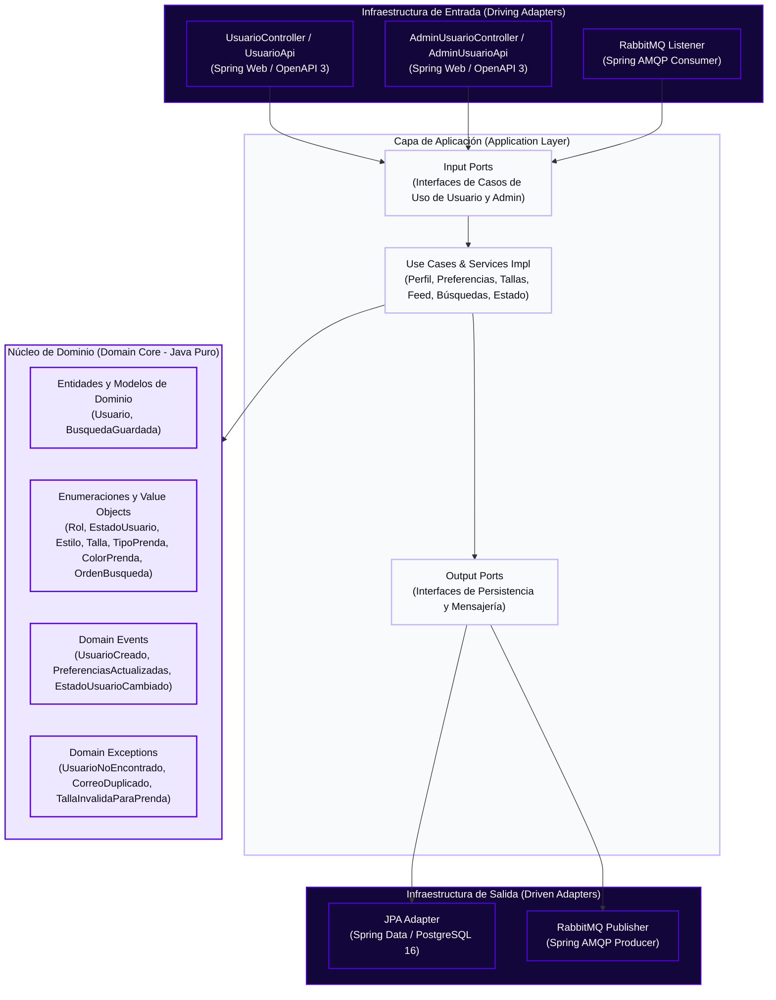
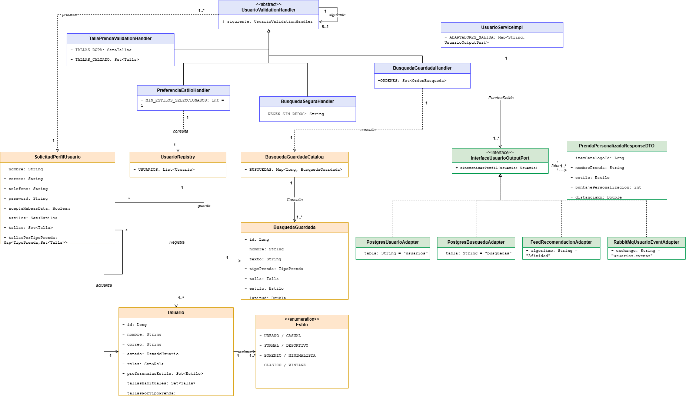
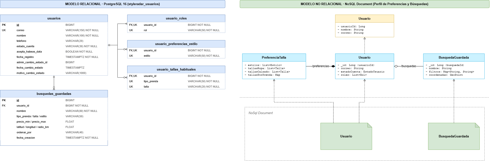
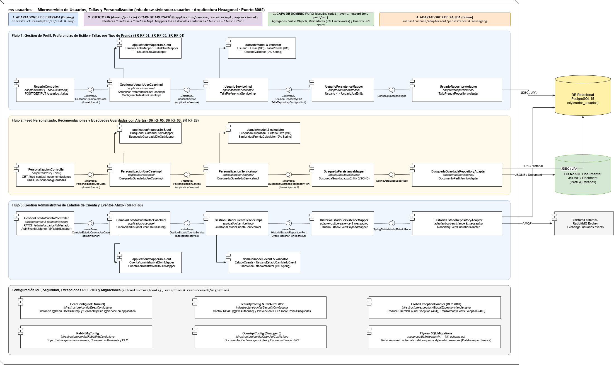
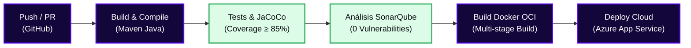

<!-- ==============================================================================
  STYLE RADAR 
  Asignatura: DOSW · 2026
  Estándar obligatorio unificado para los 13 microservicios del proyecto StyleRadar.
============================================================================== -->

<div align="center">

  <a href="https://github.com/StyleRadar1">
    
  </a>

  <h1>STYLE<font color="#5600EF">RADAR</font> &nbsp;·&nbsp; <code>ms-usuarios</code></h1>

  <p align="center">
    
    
    
  </p>

  <p align="center">
    <strong><font color="#5600EF">Descubre tu estilo. En tu ciudad.</font></strong><br />
    <em>Plataforma de moda local con inventario multi-sede geolocalizado en tiempo real y probador virtual para Bogotá.</em>
  </p>

  <p align="center">
    <a href="https://styleradar-backend-prod.azurewebsites.net/swagger-ui/index.html">
      
    </a>
    <a href="https://styleradar-backend-qa.azurewebsites.net/swagger-ui/index.html">
      
    </a>
    <a href="https://sonarcloud.io/organizations/styleradar/projects">
      
    </a>
    <a href="target/site/jacoco/index.html">
      
    </a>
    <a href="#6-tecnologías-y-dependencias">
      
    </a>
    <a href="#6-tecnologías-y-dependencias">
      
    </a>
    <a href="#7-cómo-ejecutar-local-y-con-docker">
      
    </a>
  </p>

</div>


---

##  ÍNDICE DE CONTENIDOS

1. [Nombre del servicio y su bounded context](#1-nombre-del-servicio-y-su-bounded-context)
2. [Equipo y responsables](#2-equipo-y-responsables)
3. [Arquitectura hexagonal con su diagrama](#3-arquitectura-hexagonal-con-su-diagrama)
4. [Endpoints y enlace a Swagger](#4-endpoints-y-enlace-a-swagger)
5. [Eventos que publica y consume](#5-eventos-que-publica-y-consume)
6. [Tecnologías y dependencias](#6-tecnologías-y-dependencias)
7. [Cómo ejecutar local y con Docker](#7-cómo-ejecutar-local-y-con-docker)
8. [Variables de entorno](#8-variables-de-entorno)
9. [Pruebas y cobertura](#9-pruebas-y-cobertura)
10. [CI/CD con el badge del pipeline](#10-cicd-con-el-badge-del-pipeline)
11. [Ramas y cómo contribuir](#11-ramas-y-cómo-contribuir)
12. [Enlace a la épica en Jira](#12-enlace-a-la-épica-en-jira)
13. [Análisis de tecnologías del servicio](#13-análisis-de-tecnologías-del-servicio)

---

<a id="1-nombre-del-servicio-y-su-bounded-context"></a>

##  1. NOMBRE DEL SERVICIO Y SU BOUNDED CONTEXT

* **Identificador de Servicio:** `ms-usuarios` (`CADCHE-Users-Service`)
* **Paquete Arquitectónico:** `Paquete 1: Identidad`
* **Puerto de Escucha Oficial:** `8082` (definido en la matriz de puertos sin colisión)
* **Base de Datos Asignada:** `PostgreSQL 16` (`styleradar_usuarios`), aislada bajo el patrón *Database-per-Service*.
* **Bounded Context:** `Gestión de Perfiles de Usuario, Preferencias de Estilo, Tallas y Búsquedas Guardadas`

### Responsabilidades del Dominio

Este microservicio encapsula exclusivamente la lógica de negocio correspondiente a `Gestión de Perfiles de Usuario, Preferencias de Estilo, Tallas y Búsquedas Guardadas`.

| Qué HACE este Microservicio (Alcance) | Qué NO HACE este Microservicio (Límites) |
| :--- | :--- |
| • Registra y consulta el perfil de usuarios compradores (`SR-RF-01`), validando unicidad de correo y aceptación de Habeas Data (`SR-RNF-02`). | • NO autentica usuarios, no firma tokens JWT ni valida códigos OTP (delegado a `ms-auth` en `:8081`). |
| • Configura preferencias de estilo (`URBANO`, `CASUAL`, `FORMAL`, `DEPORTIVO`, `BOHEMIO`, `MINIMALISTA`, `CLASICO`, `VINTAGE`) con selección mínima de un estilo (`SR-RF-03`) y tallas habituales diferenciadas para ropa (`XS..XXL`) y calzado (`35..45`) (`SR-RF-04`, Deuda Técnica #9). | • NO gestiona almacenes aliados, verificación de RUT ni fundaciones aliadas (delegado a `ms-tiendas` en `:8083`). |
| • Gestiona el feed personalizado (`SR-RF-05`), las recomendaciones basadas en perfil (`SR-RF-06`), las búsquedas guardadas con coordenadas geográficas (`SR-RF-28`, Deuda Técnica #15) y la administración de estados de cuenta (`ACTIVO`, `INACTIVO`, `BLOQUEADO`, `SR-RF-66`). | • NO administra el inventario de prendas del catálogo comercial ni envía notificaciones directas (`ms-catalogo` y `ms-notificaciones`). |
| • Garantiza persistencia ACID e idempotencia en su base de datos (`styleradar_usuarios`). | • NO accede directamente a bases de datos de otros microservicios. |

### Arquetipos de Moda y Personajes de StyleRadar

<div align="center">

| Antonia (Sastre) | Mateo (Calle) | Aura (Futuro) | Nora (Rebelde) | Tomás (Esencial) |
| :---: | :---: | :---: | :---: | :---: |
| <br>**Sastre**<br><sub>Tiendas & Descubrimiento</sub> | <br>**Calle**<br><sub>Playlists & Cultura Urbana</sub> | <br>**Futuro**<br><sub>Probador Virtual AI</sub> | <br>**Rebelde**<br><sub>Segunda Vida & Vintage</sub> | <br>**Esencial**<br><sub>Fundaciones & Donaciones</sub> |

</div>

---

<a id="2-equipo-y-responsables"></a>

##  2. EQUIPO Y RESPONSABLES

Desarrollado y mantenido por el **Squad `CADche` (`CADCHE`)** para la asignatura DOSW 2026.

<div align="center">

| Rol | Nombre Completo | Usuario GitHub |
| :---: | :---: | :---: |
| **Tech Lead / Arquitecto & Backend Developer** | `Julian Camilo Giral` | `[@jcobos548](https://github.com/jcobos548)` |
| **Product Owner / Scrum Master & Backend Developer** | `Juan Diego Gaitan` | `[@mamagege](https://github.com/mamagege)` |

</div>

---

<a id="3-arquitectura-hexagonal-con-su-diagrama"></a>

##  3. ARQUITECTURA HEXAGONAL CON SU DIAGRAMA

El microservicio implementa **Arquitectura Hexagonal (Puertos y Adaptadores)** combinada con **Domain-Driven Design (DDD)**. El núcleo de negocio permanece 100% puro y aislado de frameworks, bases de datos o brokers de mensajería.

### Diagrama Interactivo de Capas (Mermaid)



<div align="center">
  <table width="100%" style="margin: 18px 0; border: 2px dashed #C4B5FD; border-radius: 8px; background-color: #FBFBFE;">
    <tr>
      <td align="center" style="padding: 20px;">
        <p>
          <br />
          <strong><font color="#5600EF" size="3">DIAGRAMAS DE ARQUITECTURA HEXAGONAL Y UML DEL SERVICIO</font></strong>
        </p>
        <p>
          <sub>Los diagramas de clases, base de datos, componentes específico y secuencia se versionan en <code>docs/uml/</code>. Archivos fuente Draw.io: <a href="docs/uml/DiagramaClases.drawio"><code>DiagramaClases.drawio</code></a> · <a href="docs/uml/DiagramaBaseDatos.drawio"><code>DiagramaBaseDatos.drawio</code></a> · <a href="docs/uml/DiagramaComponentesEspecifico.drawio"><code>DiagramaComponentesEspecifico.drawio</code></a>.</sub>
        </p>
      </td>
    </tr>
  </table>
</div>

#### 7.1 Diagrama de Clases de Dominio (`ms-usuarios`)

<div align="center">
  <br />
  <sub>Figura 7.1: Diagrama de clases del núcleo de dominio puro para ms-usuarios (Draw.io editable en <a href="docs/uml/DiagramaClases.drawio"><code>docs/uml/DiagramaClases.drawio</code></a>).</sub>
</div>

##### Justificación de Diseño y Principios Arquitecturales
El diagrama de clases de `ms-usuarios` estructura el modelo de información del usuario y su personalización aplicando Domain-Driven Design y alta cohesión:
- **Aislamiento del Dominio de Personalización**: El perfil de usuario no se limita a datos demográficos básicos, sino que incorpora de forma cohesiva la matriz de tallas por tipo de prenda y las búsquedas guardadas. El dominio se mantiene libre de dependencias de persistencia o serialización HTTP.
- **Modelado de Value Objects Específicos de Moda**: Conceptos como `TallaPrenda`, `CriterioFiltro` y `PreferenciaEstilo` se diseñan como Value Objects inmutables con validación en su construcción, garantizando que el sistema no opere con medidas físicas imposibles o categorías inexistentes.
- **Calculadores y Validadores Puros**: La lógica de correspondencia de prendas y afinidad de recomendaciones se encapsula en calculadores de dominio (`SimilaridadPrendaCalculator`), permitiendo evolucionar las heurísticas de recomendación sin tocar la infraestructura ni los controladores.

##### Explicación Detallada de los Elementos
1. **Agregado Raíz `Usuario`**:
   - `id`: Identificador global único UUID coordinado con el registro de autenticación.
   - `nombreCompleto`, `celular`, `fechaNacimiento`: Datos personales y de contacto.
   - `rol`: Rol de usuario dentro del ecosistema (`COMPRADOR`, `VENDEDOR`, `ADMINISTRADOR`).
   - `estado`: Estado de la cuenta (`ACTIVO`, `INACTIVO`, `SUSPENDIDO`).
   - `tallas`: Colección de objetos `TallaPrendaUsuario` asociados al perfil.
   - `busquedas`: Colección de entidades `BusquedaGuardada`.
   - Métodos de negocio: `actualizarPerfil()`, `configurarTalla()`, `eliminarTalla()`, `cambiarEstadoCuenta()`, `registrarBusquedaGuardada()`.
2. **Entidad `TallaPrendaUsuario`**:
   - Representa la medida física configurada por el usuario para una categoría específica de indumentaria.
   - Atributos: `tipoPrenda` (enumeración: `SUPERIOR`, `INFERIOR`, `CALZADO`, `ACCESORIOS`), `talla` (Value Object: `XS`, `S`, `M`, `L`, `XL`, `38`, `40`), `medidasCm` (mapa de dimensiones en centímetros para busto, cintura, cadera o largo de pie).
3. **Entidad `BusquedaGuardada`**:
   - Modela los criterios de búsqueda personalizados que el comprador almacena para recibir alertas y alimentar su feed.
   - Atributos: `nombreAlerta`, `criteriosFiltro` (Value Object con marcas, rangos de precio, colores y estilos), `notificarNovedad`, `fechaCreacion`.
4. **Validadores y Calculadores de Dominio**:
   - `UsuarioValidator`: Valida mayoría de edad, coherencia de números celulares y nombres completos válidos.
   - `TallaPrendaValidator`: Comprueba compatibilidad entre la categoría de prenda y el sistema de tallaje (numérico vs. alfanumérico).
   - `SimilaridadPrendaCalculator`: Calcula el índice de afinidad vectorial entre el perfil del usuario y los atributos de una prenda.
5. **Puertos de Entrada y Salida**:
   - Puertos de Entrada: `GestionarUsuarioUseCase`, `PersonalizacionUseCase`, `CambiarEstadoCuentaUseCase`.
   - Puertos de Salida: `UsuarioRepositoryPort`, `BusquedaGuardadaRepositoryPort`, `HistorialEstadoRepositoryPort`, `EventPublisherPort`.

---

#### 7.2 Diagrama de Base de Datos Relacional y No Relacional (`ms-usuarios`)

<div align="center">
  <br />
  <sub>Figura 7.2: Esquema híbrido relacional y semiestructurado JSONB en PostgreSQL 15 para ms-usuarios (Draw.io editable en <a href="docs/uml/DiagramaBaseDatos.drawio"><code>docs/uml/DiagramaBaseDatos.drawio</code></a>).</sub>
</div>

##### Justificación del Modelo Híbrido (Database-per-Service & Polyglot Persistence)
El microservicio `ms-usuarios` gestiona tanto información estrictamente relacional como datos dinámicos y semiestructurados de preferencias de moda:
- **Base de Datos Relacional (PostgreSQL 15)**: Los datos maestros de usuario, la relación 1:N entre el usuario y sus tallas por prenda, y el historial de cambios de estado administrativo exigen integridad referencial estricta, claves foráneas con comportamiento en cascada (`ON DELETE CASCADE`) y transaccionalidad ACID.
- **Persistencia Documental / JSONB en PostgreSQL**: Los criterios de búsqueda guardada y los perfiles de estilo contienen atributos altamente heterogéneos y mutables (múltiples rangos de precio, listas dinámicas de diseñadores, paletas de colores estacionales y etiquetas de ocasión). Normalizar estos filtros en múltiples tablas intermedias relacionales generaría costosos JOINs y requeriría alterar el esquema DDL con cada nueva temporada de moda. El tipo nativo `JSONB` de PostgreSQL, indexado mediante operadores GIN (`jsonb_path_ops`), proporciona la flexibilidad de una base de datos NoSQL documental combinada con las garantías ACID del motor relacional.

##### Explicación Detallada del Esquema de Datos
1. **Esquema Relacional PostgreSQL (`styleradar_usuarios`)**:
   - **Tabla `usuarios`**:
     - `id (UUID, PK)`: Llave primaria del usuario.
     - `nombre_completo (VARCHAR(150), NOT NULL)`: Nombre completo del usuario.
     - `correo (VARCHAR(150), UNIQUE, NOT NULL)`: Correo electrónico sincronizado.
     - `celular (VARCHAR(25), NULL)`: Número telefónico validado.
     - `fecha_nacimiento (DATE, NULL)`: Fecha de nacimiento para validación de edad y personalización.
     - `estado (VARCHAR(30), NOT NULL)`: `ACTIVO`, `INACTIVO`, `SUSPENDIDO`.
     - `created_at, updated_at (TIMESTAMP WITH TIME ZONE, NOT NULL)`: Auditoría temporal.
   - **Tabla `tallas_prenda_usuario`**:
     - `id (UUID, PK)`: Identificador de la talla registrada.
     - `usuario_id (UUID, FK, NOT NULL)`: Referencia a `usuarios(id)` con `ON DELETE CASCADE`.
     - `tipo_prenda (VARCHAR(50), NOT NULL)`: Categoría de prenda (`SUPERIOR`, `INFERIOR`, `CALZADO`, etc.).
     - `talla (VARCHAR(20), NOT NULL)`: Valor de la talla (`M`, `38`, `L`).
     - `medidas_cm (VARCHAR(255), NULL)`: Detalle dimensional complementario.
     - Restricción: `UNIQUE(usuario_id, tipo_prenda)` que impide registros duplicados para una misma categoría.
   - **Tabla `historial_estado_cuenta`**:
     - `id (UUID, PK)`: Identificador de registro histórico.
     - `usuario_id (UUID, FK, NOT NULL)`: Referencia al usuario.
     - `estado_anterior, nuevo_estado (VARCHAR(30), NOT NULL)`: Transición de estado registrada.
     - `motivo (TEXT, NOT NULL)`: Razón del cambio (sanción, inactividad o reactivación).
     - `admin_id (UUID, NULL)`: Identificador del administrador responsable si fue manual.
     - `fecha_cambio (TIMESTAMP WITH TIME ZONE, NOT NULL)`: Marca temporal de auditoría.
2. **Almacenamiento NoSQL / Documental JSONB**:
   - **Tabla `busquedas_guardadas`**:
     - `id (UUID, PK)`: Identificador de la búsqueda guardada.
     - `usuario_id (UUID, FK, NOT NULL)`: Usuario propietario de la alerta.
     - `nombre_alerta (VARCHAR(100), NOT NULL)`: Título descriptivo asignado por el comprador.
     - `criterios_filtro (JSONB, NOT NULL)`: Documento semiestructurado con estructura:
       `{"marcas": ["Zara", "Mango"], "colores": ["Negro", "Beige"], "precio_max": 250000, "estilo": "Minimalista"}`.
     - `notificar_novedad (BOOLEAN, DEFAULT TRUE)`: Flag para despacho de notificaciones automáticas.
     - Índice GIN: `CREATE INDEX idx_busquedas_criterios ON busquedas_guardadas USING gin (criterios_filtro jsonb_path_ops);` permitiendo consultas de contención (`@>`) de alto desempeño.

---

#### 7.3 Diagrama de Componentes Específico en Arquitectura Hexagonal (`ms-usuarios`)

<div align="center">
  <br />
  <sub>Figura 7.3: Diagrama de componentes específico en arquitectura hexagonal para ms-usuarios (Draw.io editable en <a href="docs/uml/DiagramaComponentesEspecifico.drawio"><code>docs/uml/DiagramaComponentesEspecifico.drawio</code></a>).</sub>
</div>

##### Justificación del Enfoque Hexagonal (Puertos y Adaptadores)
El diseño por componentes de `ms-usuarios` aísla las reglas de negocio de los detalles de transporte y almacenamiento:
- **Puertos de Entrada como Fronteras de Dominio**: Los controladores REST y consumidores AMQP únicamente interactúan con interfaces `*UseCase` ubicadas en `domain/port/in/`. No tienen visibilidad directa sobre las entidades JPA ni los adaptadores de salida.
- **Separación de Mappers In y Out**: En cumplimiento de la regla 6 del estándar hexagonal, la transformación de DTOs se divide estrictamente en `*DtoInMapper` (solicitud REST hacia dominio) y `*DtoOutMapper` (dominio hacia respuesta REST), evitando clases monolíticas de mapeo.
- **Protección contra Vulnerabilidades IDOR**: La capa de infraestructura transversal valida que los identificadores de usuario solicitados en los endpoints coincidan con el sujeto extraído del token JWT criptográfico (`SecurityConfig` y Ownership Guards).

##### Explicación Detallada de los Flujos de Componentes
1. **Flujo 1: Gestión de Perfil, Preferencias de Estilo y Tallas (SR-RF-01, SR-RF-03, SR-RF-04)**:
   - **Entrada (Driving)**: `UsuarioController` (`adapter/in/rest/`) implementa `UsuarioApi` y expone los endpoints para consultar y actualizar perfil y tallas.
   - **Puerto In y Aplicación**: Invoca `GestionarUsuarioUseCase`, cuya lógica reside en `GestionarUsuarioUseCaseImpl`, coordinado con `UsuarioDtoInMapper`, `TallaDtoInMapper` y `UsuarioDtoOutMapper`.
   - **Servicio y Dominio**: `UsuarioServiceImpl` y `TallaPreferenciaServiceImpl` aplican las invariantes mediante el agregado `Usuario`, el Value Object `TallaPrenda` y `UsuarioValidator` (0% Spring).
   - **Salida**: Se comunican a través de `UsuarioRepositoryPort` y `TallaRepositoryPort`, delegando a `UsuarioPersistenceMapper`, `SpringDataUsuarioRepo` y `UsuarioRepositoryAdapter` hacia PostgreSQL 15.
2. **Flujo 2: Feed Personalizado, Recomendaciones y Búsquedas Guardadas (SR-RF-05, SR-RF-06, SR-RF-28)**:
   - **Entrada**: `PersonalizacionController` expone `GET /feed-context`, `GET /recomendaciones` y el CRUD de `/busquedas-guardadas`.
   - **Puerto In y Aplicación**: Conexión a `PersonalizacionUseCase` y ejecución en `PersonalizacionUseCaseImpl`, asistido por `BusquedaGuardadaDtoInMapper` y `BusquedaGuardadaDtoOutMapper`.
   - **Servicio y Dominio**: `PersonalizacionServiceImpl` utiliza el modelo `BusquedaGuardada`, el Value Object `CriterioFiltro` y el motor de afinidad pura `SimilaridadPrendaCalculator`.
   - **Salida**: `BusquedaPersistenceMapper` y `BusquedaGuardadaRepositoryAdapter` persisten el documento JSONB mediante `SpringDataBusquedaRepo` sobre PostgreSQL 15.
3. **Flujo 3: Gestión Administrativa de Estados de Cuenta y Eventos AMQP (SR-RF-66)**:
   - **Entrada**: `GestionEstadoCuentaController` (`adapter/in/rest`) y `AuthEventsListener` (`adapter/in/amqp` con `@RabbitListener` que sincroniza altas de usuarios desde `ms-auth`).
   - **Puerto In y Aplicación**: Invoca `CambiarEstadoCuentaUseCase` e interactúa con `CambiarEstadoCuentaUseCaseImpl`.
   - **Servicio y Dominio**: `GestionEstadoCuentaServiceImpl` valida la transición mediante `TransicionEstadoValidator` e instancia el evento `UsuarioEstadoCambiadoEvent`.
   - **Salida**: `HistorialEstadoPersistenceMapper` y `HistorialEstadoRepositoryAdapter` registran la auditoría en PostgreSQL, mientras que `RabbitMqEventPublisherAdapter` publica la notificación al Topic Exchange `usuarios.events`.
4. **Banda Transversal de Infraestructura**:
   - `BeanConfig.java`: Registra `@Bean` para use cases y servicios de aplicación manteniendo la pureza de las clases.
   - `SecurityConfig.java` & `JwtAuthFilter`: Restringe accesos administrativos mediante `@PreAuthorize("hasRole('ADMINISTRADOR')")` y previene vulnerabilidades IDOR en perfiles.
   - `GlobalExceptionHandler.java`: Mapea errores de dominio (`UserNotFoundException`, `DuplicateSizeException`) a respuestas normalizadas RFC 7807 Problem Details.
   - `RabbitMqConfig.java`: Configura colas, Topic Exchanges y DLQ para eventos de usuarios.
   - `OpenApiConfig.java`: Swagger 3 con esquemas OpenAPI 3.0 documentados.
   - `Flyway SQL Migrations` (`V1__init_schema.sql`): Control de versiones del esquema `styleradar_usuarios`.

### Estructura Oficial de Paquetes en `src/main/java/`

```text
src/main/java/edu/dosw/styleradar/usuarios/
├── UsuariosApplication.java                 <-- Punto de entrada Spring Boot (ms-usuarios)
├── domain/                                  <-- NÚCLEO DE DOMINIO (Cero dependencias externas)
│   ├── model/                               <-- Modelos y enumeraciones (Rol, EstadoUsuario, Estilo, Talla, TipoPrenda, ColorPrenda, OrdenBusqueda)
│   ├── event/                               <-- Definición de Eventos de Dominio
│   ├── exception/                           <-- Excepciones de reglas de negocio
│   └── port/
│       ├── in/                              <-- Input Ports (Interfaces de casos de uso)
│       └── out/                             <-- Output Ports (Interfaces para repositorios y broker)
├── application/                             <-- CAPA DE APLICACIÓN (Casos de Uso y Servicios)
│   ├── dto/
│   │   ├── request/                         <-- DTOs de entrada (RegistrarUsuarioRequestDTO, PreferenciasEstiloRequestDTO, TallasHabitualesRequestDTO, GuardarBusquedaRequestDTO, CambiarEstadoUsuarioRequestDTO)
│   │   ├── response/                        <-- DTOs de salida (UsuarioResponseDTO, AdminUsuarioResponseDTO, BusquedaGuardadaResponseDTO, PrendaPersonalizadaResponseDTO, PageResponseDTO, ErrorResponseDTO)
│   │   └── event/                           <-- Payloads de eventos de integración
│   ├── mapper/
│   │   ├── in/                              <-- Mappers de entrada REST/AMQP a Dominio
│   │   └── out/                             <-- Mappers de salida Dominio a Persistencia/Eventos
│   ├── service/
│   │   └── impl/                            <-- Servicios de aplicación e implementaciones (<Nombre>Impl)
│   └── usecase/                             <-- Implementación de casos de uso (<Nombre>UseCaseImpl)
└── infrastructure/                          <-- CAPA DE INFRAESTRUCTURA (Adaptadores)
    ├── adapter/
    │   ├── in/
    │   │   ├── rest/                        <-- Controladores REST (UsuarioController, AdminUsuarioController) y contratos OpenAPI (doc/UsuarioApi, doc/AdminUsuarioApi)
    │   │   ├── amqp/                        <-- Consumidores de eventos RabbitMQ
    │   │   └── websocket/                   <-- Adaptadores de entrada en tiempo real
    │   └── out/
    │       ├── persistence/                 <-- Entidades SQL (entity/) y Repositorios JPA (repository/)
    │       ├── security/                    <-- Filtros y utilidades de validación de contexto JWT
    │       ├── messaging/                   <-- Productores de eventos RabbitMQ
    │       └── external/                    <-- Clientes de servicios externos
    ├── config/                              <-- Configuración Spring (SwaggerConfig)
    └── exception/                           <-- Manejo centralizado de errores HTTP (GlobalExceptionHandler)
```

---

<a id="4-endpoints-y-enlace-a-swagger"></a>

##  4. ENDPOINTS Y ENLACE A SWAGGER

La documentación interactiva OpenAPI 3.0 y los contratos de ejecución se encuentran desplegados y clasificados por entorno:

### Matriz Oficial de Enlaces por Entorno (PROD, QA, LOCAL)

| Entorno | Estado | Propósito | URL Base del Servicio | Swagger OpenAPI UI | Health Check |
| :--- | :---: | :--- | :--- | :--- | :--- |
| **Producción (PROD)** | Active | Despliegue productivo de StyleRadar | `https://styleradar-backend-prod.azurewebsites.net` | [Swagger UI PROD](https://styleradar-backend-prod.azurewebsites.net/swagger-ui/index.html) | [`/actuator/health`](https://styleradar-backend-prod.azurewebsites.net/actuator/health) |
| **Calidad / Pruebas (QA)** | Active | Pruebas integradas de Sprint y QA | `https://styleradar-backend-qa.azurewebsites.net` | [Swagger UI QA](https://styleradar-backend-qa.azurewebsites.net/swagger-ui/index.html) | [`/actuator/health`](https://styleradar-backend-qa.azurewebsites.net/actuator/health) |
| **Desarrollo Local (DEV)** | Local | Entorno de desarrollo local en máquina | `http://localhost:8082` | [Swagger UI Local](http://localhost:8082/swagger-ui.html) | [`/actuator/health`](http://localhost:8082/actuator/health) |

* **Especificación OpenAPI (Contrato JSON Schema):** `http://localhost:8082/v3/api-docs` (o `/v3/api-docs` en los dominios de PROD y QA).


<div align="center">
  <table width="100%" style="margin: 18px 0; border: 2px dashed #5600EF; border-radius: 8px; background-color: #FBFBFE;">
    <tr>
      <td align="center" style="padding: 22px;">
        <p>
          <br />
          <strong><font color="#5600EF" size="3">DOCUMENTACIÓN SWAGGER OPENAPI UI ACTIVA</font></strong>
        </p>
        <p>
          <sub>Pega aquí la captura de pantalla de la interfaz interactiva corriendo en <code>http://localhost:8082/swagger-ui.html</code> mostrando los endpoints del controlador.</sub>
        </p>
        <p>
<!-- Al generar tu captura, descomenta la siguiente línea y guarda la imagen en la ruta indicada: -->
<!-- <br /> -->
          <code>[ Pegar captura de Swagger UI aquí · docs/evidencias/swagger-ui.png ]</code>
        </p>
      </td>
    </tr>
  </table>
</div>

### Tabla de Endpoints Expuestos

| Método | Endpoint | Descripción | Rol Requerido | Códigos HTTP |
| :---: | :--- | :--- | :--- | :---: |
| `POST` | `/api/v1/usuarios` | Registro de perfil de usuario comprador con validación de Habeas Data (`SR-RF-01`, `SR-RNF-02`) | Público | `201`, `400`, `409` |
| `GET` | `/api/v1/usuarios/me` | Consulta del perfil completo del usuario comprador autenticado (`SR-RF-01`) | `COMPRADOR` | `200`, `401` |
| `GET` | `/api/v1/usuarios/{id}` | Consulta de perfil de usuario por identificador único (`SR-RF-66`) | `ADMIN_STYLERADAR` | `200`, `401`, `403`, `404` |
| `PUT` | `/api/v1/usuarios/me/preferencias` | Actualización de preferencias de estilo del comprador (mínimo 1 estilo) (`SR-RF-03`) | `COMPRADOR` | `200`, `400`, `401` |
| `PUT` | `/api/v1/usuarios/me/preferencias-estilo` | Alias de compatibilidad para actualización de preferencias de estilo (`SR-RF-03`) | `COMPRADOR` | `200`, `400`, `401` |
| `PUT` | `/api/v1/usuarios/me/tallas` | Configuración de tallas habituales diferenciadas para ropa y calzado (`SR-RF-04`, Deuda Técnica #9) | `COMPRADOR` | `200`, `400`, `401` |
| `PUT` | `/api/v1/usuarios/me/tallas-habituales` | Alias de compatibilidad para actualización de tallas habituales (`SR-RF-04`, Deuda Técnica #9) | `COMPRADOR` | `200`, `400`, `401` |
| `GET` | `/api/v1/usuarios/me/feed` | Feed paginado de prendas sugeridas según estilos y tallas del comprador (`SR-RF-05`) | `COMPRADOR` | `200`, `400`, `401` |
| `GET` | `/api/v1/usuarios/me/recomendaciones` | Recomendaciones personalizadas basadas en preferencias y búsquedas guardadas (`SR-RF-06`) | `COMPRADOR` | `200`, `400`, `401` |
| `POST` | `/api/v1/usuarios/me/busquedas-guardadas` | Guardar combinación de filtros y coordenadas de búsqueda frecuente (`SR-RF-28`, Deuda Técnica #15) | `COMPRADOR` | `201`, `400`, `401` |
| `GET` | `/api/v1/usuarios/me/busquedas-guardadas` | Listar búsquedas guardadas del usuario autenticado (`SR-RF-28`) | `COMPRADOR` | `200`, `401` |
| `DELETE` | `/api/v1/usuarios/me/busquedas-guardadas/{busquedaId}` | Eliminar una búsqueda guardada por su identificador (`SR-RF-28`) | `COMPRADOR` | `204`, `401`, `404` |
| `GET` | `/api/v1/admin/usuarios` | Listado paginado de usuarios filtrable por rol y estado (`SR-RF-66`) | `ADMIN_STYLERADAR` | `200`, `400`, `401`, `403` |
| `GET` | `/api/v1/admin/usuarios/{id}` | Detalle administrativo de una cuenta de usuario (`SR-RF-66`) | `ADMIN_STYLERADAR` | `200`, `401`, `403`, `404` |
| `PATCH` | `/api/v1/admin/usuarios/{id}/estado` | Cambio de estado de cuenta (`ACTIVO`, `INACTIVO`, `BLOQUEADO`) con motivo (`SR-RF-66`) | `ADMIN_STYLERADAR` | `200`, `400`, `401`, `403`, `404` |
| `GET` | `/actuator/health` | Health Check y estado operativo del microservicio | Público | `200` |

<details>
<summary><b>Click para ver Ejemplos Interactivos de Request y Response JSON (Payloads)</b></summary>

<br>

#### Ejemplo Request (`PUT /api/v1/usuarios/me/tallas`)

```bash
curl -X PUT "http://localhost:8082/api/v1/usuarios/me/tallas" \
  -H "Content-Type: application/json" \
  -H "Authorization: Bearer <JWT_TOKEN>" \
  -d '{
    "tallas": ["S", "M", "38"],
    "tallasPorTipoPrenda": {
      "CAMISETA": ["S", "M"],
      "PANTALON": ["M"],
      "CALZADO": ["38", "39"]
    }
  }'
```

#### Ejemplo Response Exitoso (`200 OK`)

```json
{
  "id": 1,
  "nombre": "Camila Torres",
  "correo": "camila.torres@correo.com",
  "telefono": "3001234567",
  "roles": ["COMPRADOR"],
  "estado": "ACTIVO",
  "preferenciasEstilo": ["URBANO", "CASUAL", "VINTAGE"],
  "tallasHabituales": ["S", "M", "38"],
  "tallasPorTipoPrenda": {
    "CAMISETA": ["S", "M"],
    "PANTALON": ["M"],
    "CALZADO": ["38", "39"]
  },
  "fechaCreacion": "2026-04-12T10:15:30"
}
```

#### Ejemplo Request (`PATCH /api/v1/admin/usuarios/1/estado`)

```bash
curl -X PATCH "http://localhost:8082/api/v1/admin/usuarios/1/estado" \
  -H "Content-Type: application/json" \
  -H "Authorization: Bearer <JWT_ADMIN_TOKEN>" \
  -d '{
    "estado": "BLOQUEADO",
    "motivo": "Incumplimiento reiterado de políticas de publicación en segunda mano"
  }'
```

#### Ejemplo Response Exitoso (`200 OK`)

```json
{
  "id": 1,
  "nombre": "Camila Torres",
  "correo": "camila.torres@correo.com",
  "telefono": "3001234567",
  "roles": ["COMPRADOR"],
  "estado": "BLOQUEADO",
  "motivoEstado": "Incumplimiento reiterado de políticas de publicación en segunda mano",
  "fechaCreacion": "2026-04-12T10:15:30",
  "fechaCambioEstado": "2026-04-18T11:20:00"
}
```

</details>

---

<a id="5-eventos-que-publica-y-consume"></a>

##  5. EVENTOS QUE PUBLICA Y CONSUME

La comunicación asíncrona entre microservicios se orquesta a través de **RabbitMQ 3.12** utilizando Topic Exchanges durables.

* **Exchange Principal de Dominio:** `styleradar.usuarios.events` / `styleradar.events` (`topic`, durable)
* **Exchange de Auditoría:** `styleradar.audit` (`fanout`, durable)
* **Dead Letter Exchange (DLX):** `styleradar.dlx`

### Matriz de Eventos AMQP

| Tipo | Routing Key | Cola (Queue) | Microservicio Emisor / Receptor | Cuándo se Dispara / Acción |
| :---: | :--- | :--- | :--- | :--- |
| **PUBLICA** | `usuario.perfil.actualizado` | N/A (Exchange) | `ms-usuarios` &rarr; `ms-busqueda` | Se publica cuando el comprador actualiza sus `preferenciasEstilo` o `tallasPorTipoPrenda` (`SR-RF-03`, `SR-RF-04`) para recalcular feed y recomendaciones (`SR-RF-05`, `SR-RF-06`). |
| **PUBLICA** | `usuario.estado.cambiado` | N/A (Exchange) | `ms-usuarios` &rarr; `ms-auth`, `ms-segunda-mano` | Se publica cuando `ADMIN_STYLERADAR` cambia el estado de una cuenta a `ACTIVO`, `INACTIVO` o `BLOQUEADO` (`SR-RF-66`), revocando sesiones en `ms-auth`. |
| **CONSUME** | `auth.usuario.registrado` | `q.usuarios.registro` | `ms-auth` &rarr; `ms-usuarios` | Crea o sincroniza el perfil base del usuario tras el registro en el servicio de autenticación (`SR-RF-01`). |
| **CONSUME** | `tienda.rol.asignado` | `q.usuarios.rol` | `ms-tiendas` &rarr; `ms-usuarios` | Añade el rol `ADMIN_ALMACEN` o `REPRESENTANTE_FUNDACION` al perfil del usuario (`SR-RF-62`, `SR-RF-63`). |

<details>
<summary><b>Click para ver Esquema JSON del Evento Publicado (con Idempotencia)</b></summary>

<br>

```json
{
  "eventId": "018e3a2b-3333-7000-8000-000000000002",
  "eventType": "usuario.estado.cambiado",
  "timestamp": "2026-11-01T14:30:00Z",
  "producer": "ms-usuarios",
  "correlationId": "corr-usr-estado-0001",
  "data": {
    "usuarioId": 1,
    "correo": "camila.torres@correo.com",
    "estadoAnterior": "ACTIVO",
    "estadoNuevo": "BLOQUEADO",
    "motivo": "Incumplimiento reiterado de políticas de publicación",
    "version": 2
  }
}
```

</details>

---

<a id="6-tecnologías-y-dependencias"></a>

##  6. TECNOLOGÍAS Y DEPENDENCIAS

El stack del microservicio cumple con el estándar unificado de arquitectura de StyleRadar:

| Capa / Componente | Tecnología | Versión | Justificación Técnica |
| :--- | :--- | :--- | :--- |
| **Lenguaje Core** | Java LTS | `17 / 21 LTS` | Records inmutables para DTOs, tipado seguro y alto desempeño de ejecución. |
| **Framework Empresarial** | Spring Boot | `3.2.12` | Gestión declarativa de configuración, Spring Web, Spring Validation y Actuator. |
| **Base de Datos** | PostgreSQL con soporte JSONB | `16` | Integridad relacional ACID para perfiles y tallas, combinada con columnas JSONB indexadas con GIN para búsquedas guardadas. |
| **Caché en Memoria** | Redis | `7.x` | Almacenamiento en caché de perfiles y preferencias de estilo de usuarios activos. |
| **Migraciones de BD** | Flyway | `10.20.1` | Control de versiones reproducible del esquema SQL (`styleradar_usuarios`). |
| **Broker de Mensajería** | RabbitMQ | `3.12+` | Sincronización eventual de estados de cuenta y preferencias con `ms-auth` y `ms-busqueda`. |
| **Validación de Contratos** | Jakarta Bean Validation | `3.0.x` | Validación declarativa sin vulnerabilidades ReDoS (mitigación Deuda Técnica #15 en expresiones regulares). |
| **Mapeo de DTOs** | MapStruct + Lombok | `1.5.5.Final / 1.18.42` | Generación de mappers en tiempo de compilación sin sobrecarga por reflexión. |
| **Documentación API** | SpringDoc OpenAPI | `2.3.0` | Exposición automática del esquema OpenAPI 3.0 y consola interactiva `/swagger-ui.html`. |
| **Testing Core & Integración** | JUnit 5, Mockito, Testcontainers | `5.10.x / 1.19.8` | Pruebas unitarias de dominio, verificación de contrato OpenAPI y contenedores efímeros PostgreSQL. |

> Nota: El análisis formal exhaustivo basado en la Plantilla Maestra Oficial (Drivers de Calidad ISO/IEC 25010, Metodología MCDM/Pugh Matrix, Matrices de Decisión ADR-001 a ADR-005, Costos Cloud TCO/FinOps, Tech Radar, Matriz de Riesgos y Acta de Aprobación) se encuentra documentado en la [Sección 13: Análisis de Tecnologías del Servicio](#13-análisis-de-tecnologías-del-servicio).

---

<a id="7-cómo-ejecutar-local-y-con-docker"></a>

##  7. CÓMO EJECUTAR LOCAL Y CON DOCKER

### Prerrequisitos de Entorno

* **Java Development Kit (JDK):** Versión 17 o 21 LTS instalada (`java -version`).
* **Apache Maven:** Versión 3.9+ instalada (`mvn -version`).
* **Docker Engine & Docker Compose:** Versión 24+ en ejecución (`docker --version`).

### Ejecución Local con Maven (Perfil Dev / Test)

```bash
# 1. Clonar el repositorio
git clone https://github.com/StyleRadar1/CADCHE-Users-Service.git
cd CADCHE-Users-Service

# 2. Levantar servicios de infraestructura en Docker (PostgreSQL, RabbitMQ)
docker compose up -d postgres rabbitmq

# 3. Ejecutar el microservicio localmente con PostgreSQL (perfil dev)
mvn clean spring-boot:run -Dspring-boot.run.profiles=dev

# Alternativa rápida sin PostgreSQL externo (usando configuración en memoria de test)
mvn spring-boot:run -Dspring-boot.run.useTestClasspath=true -Dspring-boot.run.profiles=test
```

### Ejecución Contenerizada Completa con Docker

<details>
<summary><b>Click para ver Instrucciones de Docker y docker-compose.yml de Ejemplo</b></summary>

<br>

```bash
# Compilar y empaquetar el JAR ejecutable omitiendo tests
mvn clean package -DskipTests

# Construir la imagen OCI local
docker build -t styleradar/ms-usuarios:v1.0 .

# Ejecutar el contenedor conectado a la red compartida de StyleRadar
docker run -d \
  --name ms-usuarios \
  --network styleradar-net \
  -p 8082:8082 \
  --env-file .env \
  styleradar/ms-usuarios:v1.0
```

#### Archivo `docker-compose.yml` de Soporte

```yaml
version: '3.8'

networks:
  styleradar-net:
    driver: bridge

services:
  ms-usuarios:
    build: .
    container_name: ms-usuarios
    restart: always
    ports:
      - "8082:8082"
    environment:
      - SPRING_PROFILES_ACTIVE=docker
      - SERVER_PORT=8082
      - DB_URL=jdbc:postgresql://postgres:5432/styleradar_usuarios
      - DB_USERNAME=postgres
      - DB_PASSWORD=postgres
      - JPA_DDL_AUTO=validate
      - FLYWAY_ENABLED=true
      - RABBITMQ_HOST=rabbitmq
      - RABBITMQ_PORT=5672
    depends_on:
      - postgres
      - rabbitmq
    networks:
      - styleradar-net

  postgres:
    image: postgres:16-alpine
    container_name: sr-postgres-usuarios
    environment:
      POSTGRES_DB: styleradar_usuarios
      POSTGRES_USER: postgres
      POSTGRES_PASSWORD: postgres
    ports:
      - "5432:5432"
    networks:
      - styleradar-net

  rabbitmq:
    image: rabbitmq:3.12-management-alpine
    container_name: sr-rabbitmq-usuarios
    ports:
      - "5672:5672"
      - "15672:15672"
    networks:
      - styleradar-net
```

</details>

### Comprobación de Salud (Health Check)

```bash
curl -s http://localhost:8082/actuator/health | jq .
# Esperado: {"status":"UP"}
```

<div align="center">
  <table width="100%" style="margin: 18px 0; border: 2px dashed #5600EF; border-radius: 8px; background-color: #FBFBFE;">
    <tr>
      <td align="center" style="padding: 22px;">
        <p>
          <br />
          <strong><font color="#5600EF" size="3">CONTENEDOR OCI DOCKER EN EJECUCIÓN (docker compose ps)</font></strong>
        </p>
        <p>
          <sub>Pega aquí la captura de terminal ejecutando <code>docker compose ps</code> mostrando el contenedor del microservicio y sus servicios de persistencia y broker en estado healthy.</sub>
        </p>
        <p>
<!-- Al generar tu captura, descomenta la siguiente línea y guarda la imagen en la ruta indicada: -->
<!-- <br /> -->
          <code>[ Pegar captura de Docker compose ps aquí · docs/evidencias/docker-compose-ps.png ]</code>
        </p>
      </td>
    </tr>
  </table>
</div>


---

<a id="8-variables-de-entorno"></a>

##  8. VARIABLES DE ENTORNO

Todas las configuraciones sensibles y dependientes de entorno se externalizan mediante variables de sistema conformes al estándar **Twelve-Factor App**.

| Variable | Descripción | Valor por Defecto (`dev`) | Requerido en Prod |
| :--- | :--- | :--- | :---: |
| `SERVER_PORT` | Puerto de escucha HTTP del microservicio | `8082` | Sí |
| `SPRING_PROFILES_ACTIVE` | Perfil de configuración Spring Boot activo | `dev` | Sí |
| `DB_URL` | URL JDBC de conexión a PostgreSQL | `jdbc:postgresql://localhost:5432/styleradar_usuarios` | Sí |
| `DB_USERNAME` | Usuario de conexión a la base de datos | `postgres` | Sí |
| `DB_PASSWORD` | Contraseña del usuario de base de datos | `postgres` | Sí |
| `JPA_DDL_AUTO` | Estrategia de validación de esquema Hibernate | `validate` | Sí |
| `FLYWAY_ENABLED` | Ejecución automática de migraciones Flyway | `false` (`true` en prod) | Sí |
| `RABBITMQ_HOST` | Hostname del broker de mensajería RabbitMQ | `localhost` | Sí |
| `RABBITMQ_PORT` | Puerto AMQP de RabbitMQ | `5672` | Sí |
| `RABBITMQ_USERNAME` | Usuario de conexión a RabbitMQ | `guest` | Sí |
| `RABBITMQ_PASSWORD` | Contraseña de conexión a RabbitMQ | `guest` | Sí |
| `JWT_SECRET` | Clave secreta o pública para validar tokens JWT | `<SECRET_KEY_256_BITS>` | Sí |

<details>
<summary><b>Click para copiar la Plantilla de Archivo .env.example</b></summary>

<br>

```dotenv
# ==============================================================================
# STYLERADAR · ms-usuarios · VARIABLES DE ENTORNO LOCALES (.env)
# ==============================================================================
SERVER_PORT=8082
SPRING_PROFILES_ACTIVE=dev

# Persistencia PostgreSQL
DB_URL=jdbc:postgresql://localhost:5432/styleradar_usuarios
DB_USERNAME=postgres
DB_PASSWORD=postgres
JPA_DDL_AUTO=validate
FLYWAY_ENABLED=false

# Event Broker RabbitMQ
RABBITMQ_HOST=localhost
RABBITMQ_PORT=5672
RABBITMQ_USERNAME=guest
RABBITMQ_PASSWORD=guest

# Seguridad JWT
JWT_SECRET=change_this_secret_in_production_minimum_32_characters
```

</details>

---

<a id="9-pruebas-y-cobertura"></a>

##  9. PRUEBAS Y COBERTURA (≥ 85%)

El proyecto exige una cobertura de código mínima del **85%** verificada automáticamente mediante el plugin de **JaCoCo** durante la fase de compilación.

### Comandos de Ejecución de Pruebas

```bash
# Ejecutar todas las pruebas unitarias, de contrato OpenAPI y de integración
mvn clean verify

# Generar únicamente el reporte HTML de JaCoCo
mvn jacoco:report
```

* **Ruta del Reporte HTML:** `target/site/jacoco/index.html`

<div align="center">
  <table width="100%" style="margin: 18px 0; border: 2px dashed #5600EF; border-radius: 8px; background-color: #FBFBFE;">
    <tr>
      <td align="center" style="padding: 22px;">
        <p>
          <br />
          <strong><font color="#5600EF" size="3">REPORTE CONSOLIDADO DE COBERTURA JACOCO (≥ 85%)</font></strong>
        </p>
        <p>
          <sub>Pega aquí la captura del reporte HTML (<code>target/site/jacoco/index.html</code>) evidenciando el cumplimiento de la cobertura mínima obligatoria (≥ 85%).</sub>
        </p>
        <p>
<!-- Al generar tu captura, descomenta la siguiente línea y guarda la imagen en la ruta indicada: -->
<!-- <br /> -->
          <code>[ Pegar captura de JaCoCo ≥ 85% aquí · docs/evidencias/cobertura-jacoco.png ]</code>
        </p>
      </td>
    </tr>
  </table>
</div>


### Pirámide de Pruebas Implementada

| Nivel de Prueba | Alcance | Tecnologías Utilizadas | Ubicación en el Código | Cobertura Meta |
| :--- | :--- | :--- | :--- | :---: |
| **Pruebas Unitarias** | Lógica de Dominio y Casos de Uso aislados | JUnit 5, Mockito, AssertJ | `src/test/java/edu/dosw/styleradar/usuarios/domain/`, `application/` | ≥ 90% |
| **Pruebas de Integración** | Repositorios JPA y Adaptadores de Persistencia | Spring Boot Test, Testcontainers | `src/test/java/edu/dosw/styleradar/usuarios/infrastructure/` | ≥ 85% |
| **Pruebas de Contrato** | Verificación de contratos OpenAPI 3 y Endpoints REST | MockMvc, SpringDoc OpenAPI Test (`SwaggerOpenApiTest`) | `src/test/java/edu/dosw/styleradar/usuarios/infrastructure/adapter/in/rest/` | ≥ 85% |

> [!IMPORTANT]
> **Criterio de Fallo en CI:** El archivo `pom.xml` contempla la regla `<limit><minimum>0.85</minimum></limit>`. Si la cobertura total consolidada es inferior al 85%, el comando `mvn verify` fallará con error y el pipeline bloqueará el Pull Request.

---

<a id="10-cicd-con-el-badge-del-pipeline"></a>

##  10. CI/CD CON EL BADGE DEL PIPELINE

El ciclo de vida del software implementa integración continua y entrega continua automatizada mediante **GitHub Actions / Azure Pipelines**:

### Matriz de Pipelines por Entorno (PROD y QA)

| Pipeline | Entorno Destino | Desencadenador (Trigger) | Quality Gate Exigido | Badge de Estado |
| :--- | :--- | :--- | :--- | :---: |
| **CI - Staging / QA** | Calidad (`QA`) | Pull Request o Push a rama `develop` | Build OK + Tests Unitarios/Integración + JaCoCo ≥ 85% + SonarQube OK | [](https://github.com/StyleRadar1/CADCHE-Users-Service/actions) |
| **CD - Producción (PROD)** | Producción (`PROD`) | Merge a rama `main` / `master` tras validación QA | Aprobación manual + Imagen OCI desplegada en Azure App Service | [](https://github.com/StyleRadar1/CADCHE-Users-Service/actions) |
| **Quality Gate SonarQube** | Transversal | Ejecutado en cada build de CI | 0 Vulnerabilidades, 0 Bugs, Deuda Técnica &lt; 5% | [](https://sonarcloud.io/organizations/styleradar/projects) |

### Diagrama del Flujo Automatizado (Pipeline Stages)



### Reglas de Calidad en SonarQube (*Quality Gate Passed*)

* **Bugs:** 0
* **Vulnerabilidades:** 0
* **Hotspots de Seguridad:** 0 revisados al 100%
* **Code Smells Críticos:** 0
* **Deuda Técnica:** < 5%

<div align="center">
  <table width="100%" style="margin: 18px 0; border: 2px dashed #5600EF; border-radius: 8px; background-color: #FBFBFE;">
    <tr>
      <td align="center" style="padding: 22px;">
        <p>
          <br />
          <strong><font color="#5600EF" size="3">EJECUCIÓN DEL PIPELINE CI/CD EN VERDE (BUILD & QUALITY GATE PASSED)</font></strong>
        </p>
        <p>
          <sub>Pega aquí la captura del pipeline de integración continua (Azure DevOps / GitHub Actions) finalizado con éxito en todas sus fases.</sub>
        </p>
        <p>
<!-- Al generar tu captura, descomenta la siguiente línea y guarda la imagen en la ruta indicada: -->
<!-- <br /> -->
          <code>[ Pegar captura del Pipeline CI/CD en verde aquí · docs/evidencias/pipeline-ci-cd.png ]</code>
        </p>
      </td>
    </tr>
  </table>
</div>

---

<a id="11-ramas-y-cómo-contribuir"></a>

##  11. RAMAS Y CÓMO CONTRIBUIR

El equipo sigue el modelo de trabajo **GitFlow adaptado para microservicios**. Las ramas `main` (`master`) y `develop` se encuentran protegidas y solo reciben cambios mediante Pull Requests aprobados.

### Estructura de Ramas Oficial

```text
main / master           <-- Código en producción (Desplegado en Azure PROD con CMV)
└── develop             <-- Rama de integración continua (Staging / QA)
    ├── feature/<tarea-o-HU>                  <-- Nuevas funcionalidades (ej. feature/swagger, feature/readme)
    ├── bugfix/<descripcion-corta>            <-- Corrección de defectos
    └── hotfix/<descripcion-corta>            <-- Parche urgente a main
```

### Convención de Commits (*Conventional Commits*)

Todo mensaje de commit debe escribirse en **minúsculas** y en **modo imperativo** siguiendo la estructura:

```text
<tipo>(<alcance>): <descripción corta en imperativo>

Tipos permitidos:
- feat: nueva funcionalidad (endpoints, casos de uso, etc.)
- fix: corrección de un bug
- refactor: cambios de código que no arreglan bugs ni añaden funciones (ej. reorganizar a hexagonal)
- test: agregar o corregir pruebas unitarias/integración
- docs: cambios en la documentación (README.md, Swagger, etc.)
- build: modificaciones en dependencias o archivos de construcción (pom.xml, etc.)
- ci: cambios en los pipelines de integración continua
- chore: tareas de mantenimiento general (archivos de configuración, .env.example, etc.)

Ejemplos válidos:
feat(usuarios): agregar soporte de tallas por tipo de prenda y coordenadas en busquedas
fix(usuarios): eliminar modificador vulnerable a redos en validacion de texto
docs(usuarios): especificar contrato openapi 3 en controladores de usuario y admin
docs(readme): estructurar documentacion tecnica del servicio ms-usuarios
```

### Checklist Obligatorio para Pull Requests

- [ ] La rama parte de la versión más reciente de `develop` (o de la rama feature base acordada).
- [ ] El código compila limpiamente con `mvn clean compile`.
- [ ] Todas las pruebas unitarias e integración pasan (`mvn verify`).
- [ ] La cobertura JaCoCo es mayor o igual al 85%.
- [ ] No se introducen credenciales, contraseñas ni tokens en el código fuente.
- [ ] El PR tiene asignado al menos 1 revisor del squad antes del merge.

---

<a id="12-enlace-a-la-épica-en-jira"></a>

##  12. ENLACE A LA ÉPICA EN JIRA

El seguimiento de requerimientos, evidencias y artefactos de entrega se centraliza en los siguientes enlaces oficiales:

### Enlaces de Gestión, Repositorios y Evidencias

* **Épica Oficial del Microservicio (Jira):** [https://mail-team-nyjtgqcj.atlassian.net/jira/software/projects/CADCHE/boards/75/backlog](https://mail-team-nyjtgqcj.atlassian.net/jira/software/projects/CADCHE/boards/75/backlog)
* **Tablero Scrum del Squad CADche (Jira):** [https://mail-team-nyjtgqcj.atlassian.net/jira/software/projects/CADCHE/boards/75/backlog](https://mail-team-nyjtgqcj.atlassian.net/jira/software/projects/CADCHE/boards/75/backlog)
* **API Swagger en Producción (PROD):** [https://styleradar-backend-prod.azurewebsites.net/swagger-ui/index.html](https://styleradar-backend-prod.azurewebsites.net/swagger-ui/index.html)
* **API Swagger en Calidad (QA):** [https://styleradar-backend-qa.azurewebsites.net/swagger-ui/index.html](https://styleradar-backend-qa.azurewebsites.net/swagger-ui/index.html)
* **Colección de Pruebas Postman:** [CatrachoINXS/StyleRadar-Backend/tree/main/postman](https://github.com/CatrachoINXS/StyleRadar-Backend/tree/main/postman)
* **Contenedor OCI Oficial (Docker Hub):** [hub.docker.com/r/juanamunoz/styleradar](https://hub.docker.com/r/juanamunoz/styleradar)
* **Video de Respaldo de la Demostración:** [Demostración Funcional en Google Drive](https://drive.google.com/file/d/1W6dklNVi8Bp8LQUx1dkGrkMlly0gRjd7/view?usp=sharing)


<div align="center">
  <table width="100%" style="margin: 18px 0; border: 2px dashed #5600EF; border-radius: 8px; background-color: #FBFBFE;">
    <tr>
      <td align="center" style="padding: 22px;">
        <p>
          <br />
          <strong><font color="#5600EF" size="3">TABLERO SCRUM Y SEGUIMIENTO DE LA ÉPICA EN JIRA</font></strong>
        </p>
        <p>
          <sub>Pega aquí la captura del tablero de Jira mostrando la Épica, User Stories y tareas asignadas al microservicio para el sprint.</sub>
        </p>
        <p>
<!-- Al generar tu captura, descomenta la siguiente línea y guarda la imagen en la ruta indicada: -->
<!-- <br /> -->
          <code>[ Pegar captura del Tablero de Jira aquí · docs/evidencias/jira-tablero-epica.png ]</code>
        </p>
      </td>
    </tr>
  </table>
</div>

### Requerimientos Funcionales Asignados

| Código RF | Nombre del Requerimiento | Actor Principal | Criterio de Aceptación Clave |
| :---: | :--- | :--- | :--- |
| `SR-RF-01` | Registro y consulta de perfil de usuario comprador | `COMPRADOR` | Permite registrar y consultar el perfil del comprador validando correo único (`409 Conflict` si ya existe) y aceptación expresa de Habeas Data (`SR-RNF-02`). |
| `SR-RF-03` | Selección de preferencias de estilo del comprador | `COMPRADOR` | Permite guardar al menos un estilo (`URBANO`, `CASUAL`, `FORMAL`, `DEPORTIVO`, `BOHEMIO`, `MINIMALISTA`, `CLASICO`, `VINTAGE`) y rechaza listas vacías con `400 Bad Request`. |
| `SR-RF-04` | Configuración de tallas habituales por tipo de prenda (Deuda Técnica #9) | `COMPRADOR` | Permite configurar tallas diferenciadas para ropa (`XS` a `XXL`) y calzado (`35` a `45`) en `tallasPorTipoPrenda`, validando coherencia con `TipoPrenda`. |
| `SR-RF-05` | Visualización de feed personalizado de prendas | `COMPRADOR` | Retorna el feed paginado de prendas sugeridas priorizando coincidencias con las preferencias de estilo y tallas habituales del usuario. |
| `SR-RF-06` | Recomendaciones personalizadas de prendas | `COMPRADOR` | Retorna lista de recomendaciones calculadas según el puntaje de afinidad (`puntajePersonalizacion`) con el perfil y búsquedas del comprador. |
| `SR-RF-28` | Gestión de búsquedas guardadas (Deuda Técnica #15) | `COMPRADOR` | Permite guardar, listar y eliminar búsquedas frecuentes con filtros de prenda, precio, coordenadas (`latitud`/`longitud`) y validación segura sin vulnerabilidad ReDoS. |
| `SR-RF-66` | Administración de estados de cuenta de usuario | `ADMIN_STYLERADAR` | Permite listar usuarios con filtros por rol/estado y cambiar su estado a `ACTIVO`, `INACTIVO` o `BLOQUEADO` registrando motivo y fecha del cambio. |

---

<a id="13-análisis-de-tecnologías-del-servicio"></a>

##  13. ANÁLISIS DE TECNOLOGÍAS DEL SERVICIO (PLANTILLA MAESTRA OFICIAL)

Este apartado constituye la transcripción y aplicación integral de la **Plantilla Maestra Oficial de Análisis de Tecnologías** de StyleRadar para el microservicio `ms-usuarios` (`CADCHE-Users-Service`), desarrollada conforme al estándar de entrega de arquitectura de software para DOSW 2026.

### Ficha Técnica del Documento

* **Proyecto / Asignatura:** StyleRadar · DOSW 2026
* **Microservicio:** `CADCHE-Users-Service` (`ms-usuarios`, Puerto `8082`)
* **Paquete Arquitectónico:** Paquete 1: Identidad
* **Alcance Arquitectónico:** Evaluación multicriterio de 13 Microservicios, API Gateway y Arquitectura Orientada a Eventos
* **Equipo Responsable (CADche):** Juan Nicolás Álvarez, Camilo Ortiz, Daniel Valero, Juan Diego Valderrama, Paula Alejandra Díaz
* **Versión y Fecha:** v1.0 · Noviembre 2026

---

### 00. Resumen Ejecutivo y Estructura del Documento

El presente documento define el marco formal para evaluar, justificar y documentar la selección del stack tecnológico del microservicio `ms-usuarios`, garantizando alineación entre los atributos de calidad definidos en la norma ISO/IEC 25010 y las restricciones presupuestales y operativas del proyecto StyleRadar.

* **Servicios del Ecosistema:** 13 Microservicios + 1 API Gateway Perimetral
* **Capas Evaluadas:** 8 capas tecnológicas de extremo a extremo
* **Estándar de Empaquetado:** 100% Contenedores compatibles con OCI (Docker)
* **Latencia Meta del Sistema:** Percentil P95 inferior a 200 ms en consultas operativas

---

### 01. Contexto y Drivers Arquitectónicos (ISO/IEC 25010)

#### 1.1 Declaración del Problema y Justificación de Microservicios

El sistema StyleRadar requiere desacoplar el procesamiento intensivo de inteligencia artificial (inferencia del probador virtual) del catálogo de alta concurrencia de lectura y de la gestión de usuarios. Específicamente, `ms-usuarios` debe centralizar y aislar la personalización de la experiencia del comprador: perfiles, preferencias de vestimenta, tallas corporales por categoría de prenda, búsquedas guardadas y gobernanza administrativa de cuentas. Si las preferencias de usuario se almacenaran en la misma base de datos del catálogo o del módulo de pagos, la adición de nuevos atributos de moda (como sostenibilidad, cortes de prendas o temporadas) generaría bloqueos y migraciones riesgosas sobre tablas transaccionales. Por tanto, se adopta una arquitectura de microservicios con límites de contexto basados en Domain-Driven Design (DDD), donde `ms-usuarios` opera con su propia persistencia híbrida.

#### 1.2 Atributos de Calidad Clave (ISO/IEC 25010)

| Atributo de Calidad | Métrica / Escenario Objetivo | Impacto en la Selección Tecnológica |
| :--- | :--- | :--- |
| **Rendimiento y Latencia** | P95 < 200 ms en consultas de catálogo y feed; P99 < 500 ms | Exige motores de persistencia con índices B-Tree/GIN, caching distribuido L2 y frameworks con bajo overhead. |
| **Escalabilidad Horizontal** | Soporte de 0 a 1,000 req/s en eventos de ferias de moda | Microservicios stateless en contenedores OCI; escalado elástico independiente por réplicas. |
| **Consistencia de Datos** | ACID estricto en perfiles y tallas; eventual en recomendaciones | PostgreSQL para transaccionalidad relacional estricta; RabbitMQ para propagación de eventos asíncronos. |
| **Disponibilidad y Resiliencia** | SLA 99.9%; tolerancia al fallo de servicios downstream | Circuit Breakers (Resilience4j), degradación elegante si el motor de búsqueda no responde al actualizar perfil. |
| **Seguridad y Privacidad** | Zero Trust; validación RBAC; HTTPS TLS 1.3; Habeas Data Ley 1581 | Validación declarativa de DTOs con Jakarta Bean Validation; cifrado de datos de contacto. |
| **Eficiencia de Costos (FinOps)** | Costo mensual < $35 USD en fase MVP / académica | Aprovechamiento de Free Tiers y serverless (Container Apps con escala a cero y databases B-series). |
| **Mantenibilidad & Equipo** | Time-to-market de 8 semanas para el core MVP | Uso de tecnologías ampliamente dominadas por el equipo (Java 21 / Spring Boot) para mitigar riesgo de entrega. |

#### 1.3 Restricciones Técnicas y Organizacionales

El sistema debe empaquetarse en imágenes Docker compatibles con estándares OCI; las pruebas unitarias e integración deben alcanzar una cobertura mínima de JaCoCo igual o superior al 85% y superar el Quality Gate estricto de SonarQube con cero vulnerabilidades y cero code smells graves. La evaluación de tecnologías en esta plantilla sigue el método ATAM (Architecture Tradeoff Analysis Method), priorizando los drivers que generan mayor impacto en los riesgos del negocio y la viabilidad técnica del sistema.

---

### 02. Metodología de Evaluación Multicriterio (MCDM / Matriz de Pugh)

Para evitar decisiones basadas en preferencias subjetivas, se utiliza una matriz de decisión cuantitativa multicriterio (MCDM / Matriz de Pugh), asignando ponderaciones porcentuales basadas en los drivers arquitectónicos de StyleRadar.

#### 2.1 Criterios de Selección y Ponderaciones

| Criterio | Peso (%) | Definición y Justificación | Métrica Objetiva de Medición |
| :---: | :---: | :--- | :--- |
| **C1: Rendimiento** | 25 % | Capacidad de atender alto throughput con latencia mínima P95 y bajo consumo de memoria RAM y CPU. | Benchmarks oficiales, tiempo de respuesta bajo carga (JMeter/k6), consumo de memoria por contenedor. |
| **C2: Madurez & LTS** | 20 % | Estabilidad de APIs, soporte extendido (LTS), documentación oficial y tamaño del ecosistema. | Años en el mercado, frecuencia de parches CVE, comunidad activa en GitHub y respaldo de fundaciones. |
| **C3: Velocidad Dev** | 20 % | Curva de aprendizaje del equipo, disponibilidad de librerías listas para producción y velocidad de prototipado. | Horas requeridas para implementar un CRUD reactivo con seguridad JWT y persistencia relacional/JSONB. |
| **C4: Operabilidad** | 15 % | Facilidad de contenedorización con Docker, compatibilidad CI/CD y observabilidad con métricas y logs. | Tamaño de la imagen Docker final, soporte nativo de métricas de salud (Actuator / Healthchecks). |
| **C5: Costo & TCO** | 20 % | Costo total de propiedad en nubes públicas, tipo de licenciamiento open-source y ausencia de vendor lock-in. | Licencia OSI (Apache 2.0 / MIT / PostgreSQL), costo de instancias administradas en Azure Calculator. |

#### 2.2 Escala de Calificación Objetiva (Rúbrica 1 a 5)

* **1 - 2 (Deficiente):** No cumple el driver. Curva prohibitiva, consumo desmedido de RAM o licenciamiento restrictivo.
* **3 (Aceptable):** Cumple parcialmente con trade-offs significativos que requieren mitigación técnica adicional.
* **4 - 5 (Sobresaliente):** Excelente desempeño, soporte LTS probado en la industria y alta productividad para el equipo.

#### 2.3 Estándar de Architectural Decision Records (ADR)

Cada decisión se documenta bajo el formato formal de ADR (Michael Nygard), sintetizando el contexto, las opciones evaluadas, la decisión final justificada y las consecuencias derivadas. La puntuación total ponderada se calcula mediante la fórmula oficial:

$$\text{Puntaje Total} = \sum_{i=1}^{5} (\text{Calificación}_{i} \times \text{Peso}_{i})$$

---

### 03. Matrices de Decisión Técnicas Detalladas (ADRs de Capa)

#### 3.1 Lenguaje & Runtime de Ejecución Backend (ADR-001)

| Criterio (Peso) | Java 21 LTS (OpenJDK) | Node.js (TypeScript) | Go (Golang 1.22) | Python 3.12 (FastAPI) |
| :--- | :---: | :---: | :---: | :---: |
| C1: Rendimiento (25 %) | 5 | 4 | 5 | 3 |
| C2: Madurez & LTS (20 %) | 5 | 4 | 4 | 4 |
| C3: Velocidad Dev (20 %) | 4 | 4 | 3 | 5 |
| C4: Operabilidad (15 %) | 5 | 4 | 5 | 3 |
| C5: Costo & TCO (20 %) | 4 | 4 | 4 | 3 |
| **Total Ponderado** | **4.65 / 5.00 (Seleccionado)** | **3.95 / 5.00** | **4.30 / 5.00** | **3.55 / 5.00** |

* **Decisión ADR-001:** Se adopta Java 21 LTS como lenguaje estándar transversal para todos los microservicios backend de StyleRadar.
* **Por qué Java 21:** Tipado estático estricto para validar enumerados de tallas (`XS` a `XXL`) y estilos de vestimenta; Records inmutables para objetos de dominio y contratos DTO; recolección de basura de baja pausa en la JVM.
* **Por qué no los otros:** Node.js y Python carecen de tipado estricto en tiempo de ejecución, lo que eleva el riesgo de anomalías al deserializar documentos JSON dinámicos; Go presenta menor madurez en frameworks ORM/JPA avanzados con soporte nativo de JSONB.

#### 3.2 Framework Backend & Microservicios (ADR-002)

| Criterio (Peso) | Spring Boot 3.2.x | Quarkus 3.x | Micronaut 4.x | NestJS (Node/TS) |
| :--- | :---: | :---: | :---: | :---: |
| C1: Rendimiento (25 %) | 5 | 5 | 4 | 4 |
| C2: Madurez & LTS (20 %) | 5 | 4 | 3 | 4 |
| C3: Velocidad Dev (20 %) | 5 | 3 | 3 | 4 |
| C4: Operabilidad (15 %) | 5 | 5 | 4 | 4 |
| C5: Costo & TCO (20 %) | 4 | 5 | 5 | 4 |
| **Total Ponderado** | **4.80 / 5.00 (Seleccionado)** | **4.40 / 5.00** | **3.80 / 5.00** | **3.95 / 5.00** |

* **Decisión ADR-002:** Se adopta Spring Boot 3.2.x como framework base para la construcción del microservicio `ms-usuarios`.
* **Por qué Spring Boot:** Ecosistema maduro con soporte nativo para Jakarta Bean Validation, Spring Data JPA con tipos de columnas JSONB de Hibernate 6, integración transparente con RabbitMQ y Actuator para monitoreo.
* **Por qué no los otros:** Quarkus y Micronaut añaden complejidad al compilar con GraalVM y carecen de la facilidad de pruebas de integración con Testcontainers que ofrece el ecosistema Spring.

#### 3.3 Persistencia Relacional y Documental Nativo JSONB (ADR-003)

| Criterio (Peso) | PostgreSQL 16 con JSONB | MySQL 8.0 | MongoDB 7.0 (NoSQL) | Amazon Aurora / Cloud DB |
| :--- | :---: | :---: | :---: | :---: |
| C1: Rendimiento (25 %) | 5 | 4 | 4 | 5 |
| C2: Madurez & LTS (20 %) | 5 | 5 | 4 | 5 |
| C3: Velocidad Dev (20 %) | 5 | 4 | 4 | 4 |
| C4: Operabilidad (15 %) | 5 | 4 | 4 | 5 |
| C5: Costo & TCO (20 %) | 5 | 4 | 3 | 2 |
| **Total Ponderado** | **4.95 / 5.00 (Seleccionado)** | **4.15 / 5.00** | **3.75 / 5.00** | **4.10 / 5.00** |

* **Decisión ADR-003:** Se adopta PostgreSQL 16 con soporte nativo para columnas JSONB e índices GIN como motor de persistencia del microservicio `ms-usuarios`.
* **Por qué PostgreSQL con JSONB:** Permite combinar en un único motor tablas relacionales normalizadas para el perfil base, tallas e historial de estados de cuenta con columnas `JSONB` para criterios de búsquedas guardadas y filtros dinámicos de moda, asegurando transacciones ACID sin requerir desplegar un clúster de MongoDB adicional.
* **Por qué no los otros:** MongoDB aislado requeriría un segundo motor con su propio esquema de backups y no ofrece consistencia transaccional estricta en relaciones de clave foránea; MySQL tiene soporte JSON más limitado y no cuenta con índices GIN invertidos comparables.

#### 3.4 In-Memory Caching de Perfiles y Preferencias (ADR-004)

| Criterio (Peso) | Redis 7.x | Memcached | Hazelcast IMDG | Ehcache (Local JVM) |
| :--- | :---: | :---: | :---: | :---: |
| C1: Rendimiento (25 %) | 5 | 5 | 4 | 5 |
| C2: Madurez & LTS (20 %) | 5 | 5 | 4 | 4 |
| C3: Velocidad Dev (20 %) | 5 | 3 | 3 | 4 |
| C4: Operabilidad (15 %) | 5 | 4 | 3 | 5 |
| C5: Costo & TCO (20 %) | 4 | 5 | 3 | 5 |
| **Total Ponderado** | **4.80 / 5.00 (Seleccionado)** | **4.30 / 5.00** | **3.40 / 5.00** | **4.40 / 5.00** |

* **Decisión ADR-004:** Se adopta Redis 7.x como capa de caché distribuido para almacenar proyecciones de perfiles y preferencias de estilo de usuarios activos.
* **Por qué Redis:** Acelera la entrega de datos para el armado del feed personalizado y recomendaciones en la app móvil con latencias inferiores a un milisegundo, manteniendo sincronizadas todas las réplicas del servicio.
* **Por qué no los otros:** Ehcache reside en la memoria de la JVM de cada réplica, produciendo inconsistencias cuando una réplica actualiza el perfil y otra lee datos obsoletos; Memcached no permite indexación ni estructuras de datos complejas.

#### 3.5 Mensajería Asíncrona & Event-Driven Architecture (ADR-005)

| Criterio (Peso) | RabbitMQ 3.12+ (AMQP 0-9-1) | Apache Kafka 3.6 | AWS SQS / SNS | Redis Streams |
| :--- | :---: | :---: | :---: | :---: |
| C1: Rendimiento (25 %) | 5 | 5 | 4 | 4 |
| C2: Madurez & LTS (20 %) | 5 | 5 | 5 | 3 |
| C3: Velocidad Dev (20 %) | 5 | 3 | 4 | 4 |
| C4: Operabilidad (15 %) | 5 | 2 | 5 | 4 |
| C5: Costo & TCO (20 %) | 5 | 2 | 3 | 5 |
| **Total Ponderado** | **4.95 / 5.00 (Seleccionado)** | **3.40 / 5.00** | **4.15 / 5.00** | **3.95 / 5.00** |

* **Decisión ADR-005:** Se adopta RabbitMQ 3.12+ con Topic Exchanges para propagar eventos de negocio de `ms-usuarios`.
* **Por qué RabbitMQ:** Desacopla la sincronización de perfiles con `ms-auth`, `ms-busqueda` y `ms-segunda-mano`, garantizando que la edición de preferencias o tallas nunca falle si un consumidor downstream está temporalmente fuera de línea.
* **Por qué no los otros:** Kafka introduce sobrecostos de infraestructura desproporcionados para el intercambio de eventos transaccionales de identidad; AWS SQS limita la portabilidad hacia nubes abiertas o despliegues locales offline.

---

### 04. Análisis de Costos en la Nube (TCO Azure & FinOps)

Para garantizar la viabilidad financiera del proyecto se proyecta el Costo Total de Propiedad (TCO) comparando el escenario de desarrollo/MVP contra el escenario de producción comercial escalada en Microsoft Azure.

#### 4.1 Topología Cloud y Supuestos de Dimensionamiento

Los microservicios se ejecutan en Azure Container Apps (serverless sobre Kubernetes gestionado). La base de datos corre en Azure Database for PostgreSQL Flexible Server. El almacenamiento estático se hospeda en Azure Blob Storage (Hot LRS) y el broker de mensajería en CloudAMQP.

#### 4.2 Desglose Mensual Estimado de Costos (Azure Cloud Provider)

| Capa de Servicio | SKU / Tier Fase MVP | SKU / Tier Fase Producción | Costo MVP ($) | Costo Prod ($) |
| :--- | :--- | :--- | :---: | :---: |
| **Cómputo (13 MS + GW)** | Azure Container Apps (Consumo < 180k vCPU-s) | Container Apps Dedicado (4 réplicas activas) | $0.00 (Free) | $58.00 / mes |
| **Base de Datos Relacional** | PostgreSQL Flexible Server B1ms (1 vCPU, 2GB) | PostgreSQL Flexible Server B2s (2 vCPU, 4GB, HA) | $15.50 / mes | $42.00 / mes |
| **Caché Distribuido** | Azure Cache for Redis Basic C0 (250 MB) | Azure Cache for Redis Standard C1 (1 GB Replicado) | $16.00 / mes | $38.00 / mes |
| **Broker de Mensajería** | CloudAMQP Little Lemur (Plan Gratuito Compartido) | CloudAMQP Lemur (Dedicado 1 vCPU, 1GB) | $0.00 (Free) | $19.00 / mes |
| **Storage & CDN** | Azure Blob Storage Hot (10 GB) | Azure Blob Storage (100 GB) + Azure Front Door | $1.50 / mes | $12.00 / mes |
| **IA Probador Virtual** | FASHN AI API Free Tier (50 transformaciones) | FASHN AI Pro (500 transformaciones mensuales) | $0.00 (Free) | $45.00 / mes |
| **Logs y Monitoreo** | Log Analytics / App Insights (5 GB gratis/mes) | Application Insights Pay-as-you-go | $0.00 (Free) | $12.00 / mes |
| **TOTAL MENSUAL ESTIMADO (USD)** | | | **$33.00 / mes** | **$226.00 / mes** |

#### 4.3 Directrices FinOps para Optimización de Costos

1. **Escala a cero en valle:** Configurar reglas KEDA en Azure Container Apps para apagar réplicas inactivas entre 12:00 AM y 6:00 AM en entornos de desarrollo y staging.
2. **Caché de consultas de perfil:** Mantener en Redis las preferencias de estilo y tallas frecuentes con TTL de 1 hora, invalidando la clave únicamente ante peticiones `PUT` de actualización.
3. **Connection Pooling controlado:** HikariCP configurado a un máximo de 5 conexiones por pod en staging para evitar sobrepasar los límites de memoria RAM de la instancia PostgreSQL B1ms.

---

### 05. Radar Tecnológico (Tech Radar)

El Technology Radar de StyleRadar categoriza las tecnologías según su nivel de adopción institucional, mitigando el riesgo de obsolescencia o dispersión técnica:

#### Cuadrante 1: Lenguajes & Frameworks
* **ADOPT:** Java 21 LTS, Spring Boot 3.2.x, React 18, Tailwind CSS, Vite.
* **TRIAL:** Spring Cloud Gateway Reactive, Spring Data Specifications.
* **ASSESS:** Virtual Threads en producción masiva, Keycloak OpenID Connect.
* **HOLD:** Monolito no modular, Node.js sin TypeScript, frameworks sin tipado.

#### Cuadrante 2: Almacenamiento & Datos
* **ADOPT:** PostgreSQL 16, PostGIS, Redis 7 (Cache L2 & Locks), Azure Blob Storage.
* **TRIAL:** Índices GIN Full-Text Search en PostgreSQL para búsqueda textil.
* **ASSESS:** pgvector para búsqueda por similitud semántica de prendas.
* **HOLD:** MongoDB para transacciones de stock, MySQL sin soporte geoespacial.

#### Cuadrante 3: Plataforma & DevOps
* **ADOPT:** Docker, Docker Compose, Azure Container Apps, GitHub Actions.
* **TRIAL:** CloudAMQP RabbitMQ gestionado, Azure Front Door CDN.
* **ASSESS:** Kubernetes (AKS) bare-metal, Istio Service Mesh, OpenTelemetry.
* **HOLD:** Instancias GPU dedicadas sin auto-escalado, despliegues manuales SSH.

#### Cuadrante 4: Herramientas & Calidad
* **ADOPT:** JUnit 5, Mockito, Testcontainers, SonarQube, JaCoCo, Flyway.
* **TRIAL:** FASHN AI VTON API, SpringDoc OpenAPI (Swagger 3 UI).
* **ASSESS:** Playwright para pruebas E2E automatizadas en web móvil.
* **HOLD:** Apache Kafka para comunicación simple entre 13 microservicios.

*Criterio de transición:* Una tecnología pasa de TRIAL a ADOPT únicamente tras validar su desempeño en un sprint productivo, haber alcanzado cobertura de pruebas igual o superior al 85% y contar con documentación de arquitectura aprobada.

---

### 06. Matriz de Riesgos Técnicos y Estrategias de Mitigación

| ID | Riesgo Técnico Identificado | Prob. / Imp. | Impacto Potencial | Estrategia de Mitigación Diseñada |
| :---: | :--- | :---: | :--- | :--- |
| **R1** | Vendor Lock-In de Servicios Cloud | Baja / Medio | Dificultad de migrar la infraestructura si los costos de Azure aumentan imprevistamente. | Empaquetado OCI estándar (Docker), uso de APIs abiertas (PostgreSQL, AMQP 0-9-1) y repositorios agnósticos de almacenamiento. |
| **R2** | Latencia Elevada en Inferencia IA | Alta / Alto | Tiempos de espera de 8 a 15 segundos en el probador virtual degradando la UX del usuario. | Procesamiento asíncrono con colas RabbitMQ; polling o WebSockets en frontend; compresión previa de fotos a 720p. |
| **R3** | Agotamiento de Pool de Conexiones DB | Media / Crítico | 13 microservicios x N réplicas saturando el límite de conexiones de PostgreSQL Flexible Server. | Configuración restrictiva de HikariCP (`maximum-pool-size: 5`) por pod; uso de PgBouncer en capas de persistencia compartidas. |
| **R4** | Inconsistencia Distribuida en Inventario | Media / Crítico | Sobreventa de prendas de talla única en eventos de alta concurrencia de compras. | Bloqueos distribuidos en Redis (`Redlock`) con TTL de 5 minutos durante checkout y patrón Transaccional Outbox. |
| **R5** | Deuda Técnica por Curva de Aprendizaje | Baja / Medio | Errores de configuración o lentitud de entrega por adopción de stacks desconocidos. | Unificación del stack core en Java 21 / Spring Boot dominado por el equipo; Quality Gate obligatorio en CI/CD con SonarQube. |

#### Riesgo Crítico Específico de `ms-usuarios`: Denegación de Servicio por Expresiones Regulares (ReDoS) y Degradación JSONB
* **Riesgo:** Inyección de cadenas de búsqueda maliciosas que produzcan retroceso catastrófico en validadores de expresiones regulares (identificado como Deuda Técnica #15 en el monolito) o consultas JSONB sin indexación que fuercen escaneos secuenciales en disco.
* **Mitigación:** Adopción de Jakarta Bean Validation con restricciones declarativas de longitud fija y patrones lineales seguros; creación obligatoria de índices invertidos GIN sobre las columnas `JSONB` de la tabla `busquedas_guardadas`.

---

### 07. Matriz de Asignación Tecnológica por Microservicio (13 Servicios + GW)

Consolidación técnica oficial del ecosistema StyleRadar:

| Servicio / Puerto | Paquete de Dominio | Persistencia Primaria | Caché / In-Memory | Eventos RabbitMQ / Herramientas Clave |
| :--- | :--- | :--- | :--- | :--- |
| **`sr-api-gateway`** (`:8080`) | Perímetro | Sin estado (Stateless) | Redis (Rate Limiting) | Spring Cloud Gateway, Nimbus JWT RS256 |
| **`ms-usuarios`** (`:8082`) | **P1: Identidad** | **PostgreSQL 16 (`styleradar_usuarios`) con JSONB** | **Redis 7 (Perfiles activos)** | **Publica: `usuario.perfil.actualizado`; Spring Security** |
| **`ms-auth`** (`:8081`) | **P1: Identidad** | **PostgreSQL 16 (`styleradar_auth`)** | **Redis 7 (Blacklist JWT, OTP 300s)** | **Emisión JWT RS256, BCrypt, Exchange `styleradar.auth.events`** |
| **`ms-tiendas`** (`:8083`) | **P1: Identidad** | **PostgreSQL 16 + PostGIS** | **Redis 7 (Metadatos tienda)** | **Azure Blob Storage (Fotos tiendas aliadas, RUT PDF)** |
| **`ms-inventario`** (`:8084`) | P2: Catálogo | PostgreSQL (`stock_tallas`) | Redis Redlock (Reservas) | Publica: `stock.agotado`; Escucha: `orden.pagada` |
| **`ms-item-catalogo`** (`:8085`) | P2: Catálogo | PostgreSQL + GIN Search | Redis (Catálogo L2 TTL 1h) | Azure Blob (Fotos prendas); Moderación RF-87 |
| **`ms-probador-virtual`** (`:8086`) | P3: Experiencia | PostgreSQL (Historial VTON) | Redis (Status cola VTON) | FASHN AI API, Azure Blob, RabbitMQ async |
| **`ms-favoritos-interac`** (`:8087`) | P3: Experiencia | PostgreSQL (Favoritos) | Redis (Contadores likes) | Publica: `prenda.favorito.agregado` |
| **`ms-pagos-suscripc`** (`:8088`) | P4: Transacciones | PostgreSQL (Suscripciones) | Redis (Idempotencia) | Wompi / PSE Webhooks; Publica: `pago.exitoso` |
| **`ms-geolocalizacion`** (`:8089`) | P2: Catálogo | PostgreSQL + PostGIS | Redis (Coordenadas sedes) | Consultas ST_DWithin radio Bogotá, Nominatim |
| **`ms-notificaciones`** (`:8090`) | P5: Soporte | PostgreSQL (Logs envíos) | Redis (Plantillas correo) | Escucha topics RabbitMQ; JavaMail / WebSockets |
| **`ms-estadisticas`** (`:8091`) | P5: Soporte | PostgreSQL (Vistas mat.) | Redis (KPIs de tiendas) | Consumidor asíncrono de métricas de catálogo |
| **`ms-resenas`** (`:8092`) | P3: Experiencia | PostgreSQL (Reseñas/Calific.) | Redis (Promedios rating) | Publica: `resena.publicada`; filtro antispam |
| **`ms-auditoria-logs`** (`:8093`) | P5: Soporte | PostgreSQL (`audit_events`) | Buffer en memoria | RabbitMQ Fanout Exchange (Auditoría transversal) |

*Aislamiento por base de datos (Database-per-Service):* Cada microservicio posee su propio esquema o base de datos aislada en PostgreSQL para garantizar bajo acoplamiento e independencia total de despliegue.

#### Justificación de las Cuatro Preguntas Clave para `ms-usuarios`:

1. **¿Requiere Base de Datos o no?**
   **Sí requiere base de datos propia.** El microservicio es el propietario exclusivo de los perfiles de usuario, las preferencias de moda de cada comprador, la matriz de tallas corporales por categoría de vestuario, las combinaciones de filtros de búsquedas guardadas y el historial de suspensiones o bloqueos administrativos de cuentas. Guardar estos datos en una base compartida generaría acoplamiento indebido con el módulo de catálogo e inventario.

2. **Tipo de Base de Datos y Motor Seleccionado:**
   **Persistencia híbrida Relacional y Documental Nativo en PostgreSQL 16 con columnas JSONB + Caché en Redis 7.** Las tablas relacionales aseguran integridad ACID y claves foráneas en perfiles y tallas (`tallasPorTipoPrenda`), impidiendo que existan mediciones huérfanas. Por su parte, el tipo binario `JSONB` con índices GIN en la tabla `busquedas_guardadas` brinda la flexibilidad de un motor documental para almacenar criterios dinámicos y cambiantes de búsqueda sin ejecutar migraciones DDL de base de datos en cada nuevo filtro de moda.

3. **Frameworks, Lenguaje y Herramientas:**
   **Java 21 LTS, Spring Boot 3.2.12, Spring Data JPA con soporte JSONB de Hibernate 6, Jakarta Bean Validation 3, Flyway 10 y MapStruct 1.5.5.** Java 21 asegura inmutabilidad en DTOs y validación de tipos. Jakarta Bean Validation mitiga vulnerabilidades de denegación de servicio por expresiones regulares en campos de texto. Flyway gestiona las versiones de tablas e índices SQL, y MapStruct convierte datos entre capas sin costo de reflexión en tiempo de ejecución. El dominio se mantiene puro e independiente de Spring a través de la configuración explícita en `BeanConfig`.

4. **Broker de Mensajería:**
   **RabbitMQ 3.12+ con protocolo AMQP 0-9-1.** Se utiliza para sincronizar el estado del usuario de forma desacoplada mediante el Exchange `styleradar.usuarios.events`. Publica el evento `usuario.perfil.actualizado` hacia `ms-busqueda` para recalcular recomendaciones sin bloquear al comprador, y `usuario.estado.cambiado` hacia `ms-auth` para invalidar de inmediato sesiones de usuarios bloqueados. Asimismo, consume de forma asíncrona `auth.usuario.registrado` y `tienda.rol.asignado` para inicializar y actualizar perfiles comerciales.

---

### 08. Conclusiones Arquitectónicas y Validación Formal

#### 8.1 Resumen de Decisiones y Factores de Éxito

La adopción de Java 21 LTS y Spring Boot 3.2.x garantiza un ecosistema robusto, tipado y altamente mantenible. La persistencia híbrida con PostgreSQL 16 y soporte nativo JSONB permite una alta flexibilidad para las búsquedas guardadas y preferencias de moda sin renunciar a las garantías transaccionales ACID en los perfiles. La comunicación asíncrona con RabbitMQ 3.12+ asegura una experiencia de usuario fluida e independiente de la disponibilidad de servicios downstream.

#### 8.2 Roadmap de Evolución Tecnológica

| Fase / Sprint | Objetivo Tecnológico Clave | Criterio de Aceptación |
| :--- | :--- | :--- |
| **Sprint 1 (Semanas 1-2)** | Core arquitectónico: Gateway, Autenticación JWT y DB schemas. | Tokens validados en Gateway; Flyway migraciones ejecutadas. |
| **Sprint 2 (Semanas 3-4)** | Catálogo, geolocalización PostGIS y stock con Redis Redlock. | Búsquedas geoespaciales < 200 ms; prevención de sobreventa. |
| **Sprint 3 (Semanas 5-6)** | Integración de pagos (Wompi) y probador virtual (FASHN AI). | Webhooks procesados con idempotencia; inferencia asíncrona. |
| **Sprint 4 (Semanas 7-8)** | Pruebas E2E, Quality Gate SonarQube ≥ 85 % y despliegue cloud. | 0 vulnerabilidades; pipeline CI/CD en Azure automatizado. |

#### 8.3 Acta de Validación y Firmas del Equipo de Arquitectura

| Rol en el Proyecto | Nombre del Ingeniero | Decisión / Estado | Firma / Aprobación |
| :--- | :--- | :---: | :---: |
| **Líder de Proyecto / Product Owner** | Juan Nicolás Álvarez | APROBADO | `J. Nicolás Álvarez` |
| **Arquitecto de Software / Tech Lead** | Camilo Ortiz | APROBADO | `Camilo Ortiz` |
| **Scrum Master / Backend Developer** | Daniel Valero | APROBADO | `Daniel Valero` |
| **Fullstack / Integración Pagos** | Juan Diego Valderrama | APROBADO | `J. D. Valderrama` |
| **QA Lead & DevOps Engineer** | Paula Alejandra Díaz | APROBADO | `Paula A. Díaz` |

*Aprobación para el Desarrollo:* El presente documento constituye la línea base técnica (Technical Baseline) autorizada por el equipo CADche para el desarrollo de los microservicios de StyleRadar.
