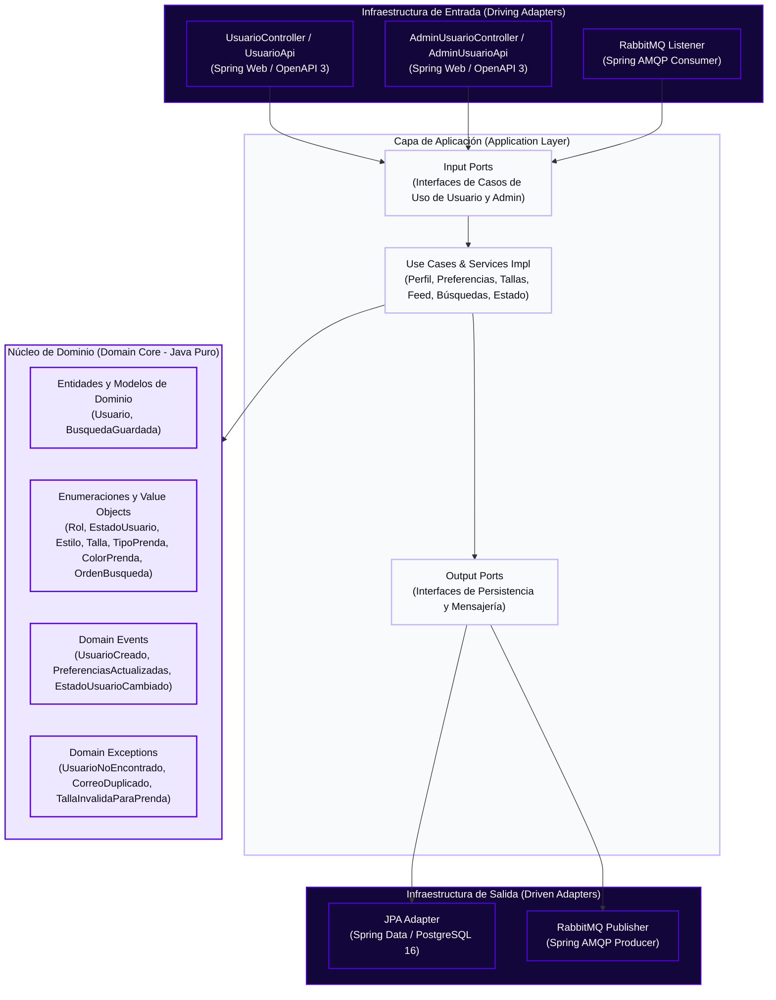
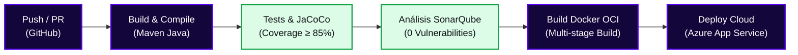

<!-- ==============================================================================
  STYLE RADAR 
  Asignatura: DOSW · 2026
  Estándar obligatorio unificado para los 13 microservicios del proyecto StyleRadar.
============================================================================== -->

<div align="center">

  <a href="https://github.com/StyleRadar1">
    
  </a>

  <h1>STYLE<font color="#5600EF">RADAR</font> &nbsp;·&nbsp; <code>ms-usuarios</code></h1>

  <p align="center">
    
    
    
  </p>

  <p align="center">
    <strong><font color="#5600EF">Descubre tu estilo. En tu ciudad.</font></strong><br />
    <em>Plataforma de moda local con inventario multi-sede geolocalizado en tiempo real y probador virtual para Bogotá.</em>
  </p>

  <p align="center">
    <a href="https://styleradar-backend-prod.azurewebsites.net/swagger-ui/index.html">
      
    </a>
    <a href="https://styleradar-backend-qa.azurewebsites.net/swagger-ui/index.html">
      
    </a>
    <a href="https://sonarcloud.io/organizations/styleradar/projects">
      
    </a>
    <a href="target/site/jacoco/index.html">
      
    </a>
    <a href="#6-tecnologías-y-dependencias">
      
    </a>
    <a href="#6-tecnologías-y-dependencias">
      
    </a>
    <a href="#7-cómo-ejecutar-local-y-con-docker">
      
    </a>
  </p>

</div>


---

##  ÍNDICE DE CONTENIDOS

1. [Nombre del servicio y su bounded context](#1-nombre-del-servicio-y-su-bounded-context)
2. [Equipo y responsables](#2-equipo-y-responsables)
3. [Arquitectura hexagonal con su diagrama](#3-arquitectura-hexagonal-con-su-diagrama)
4. [Endpoints y enlace a Swagger](#4-endpoints-y-enlace-a-swagger)
5. [Eventos que publica y consume](#5-eventos-que-publica-y-consume)
6. [Tecnologías y dependencias](#6-tecnologías-y-dependencias)
7. [Cómo ejecutar local y con Docker](#7-cómo-ejecutar-local-y-con-docker)
8. [Variables de entorno](#8-variables-de-entorno)
9. [Pruebas y cobertura](#9-pruebas-y-cobertura)
10. [CI/CD con el badge del pipeline](#10-cicd-con-el-badge-del-pipeline)
11. [Ramas y cómo contribuir](#11-ramas-y-cómo-contribuir)
12. [Enlace a la épica en Jira](#12-enlace-a-la-épica-en-jira)

---

<a id="1-nombre-del-servicio-y-su-bounded-context"></a>

##  1. NOMBRE DEL SERVICIO Y SU BOUNDED CONTEXT

* **Identificador de Servicio:** `ms-usuarios` (`CADCHE-Users-Service`)
* **Paquete Arquitectónico:** `Paquete 1: Identidad`
* **Puerto de Escucha Oficial:** `8082` (definido en la matriz de puertos sin colisión)
* **Base de Datos Asignada:** `PostgreSQL 16` (`styleradar_usuarios`), aislada bajo el patrón *Database-per-Service*.
* **Bounded Context:** `Gestión de Perfiles de Usuario, Preferencias de Estilo, Tallas y Búsquedas Guardadas`

### Responsabilidades del Dominio

Este microservicio encapsula exclusivamente la lógica de negocio correspondiente a `Gestión de Perfiles de Usuario, Preferencias de Estilo, Tallas y Búsquedas Guardadas`.

| Qué HACE este Microservicio (Alcance) | Qué NO HACE este Microservicio (Límites) |
| :--- | :--- |
| • Registra y consulta el perfil de usuarios compradores (`SR-RF-01`), validando unicidad de correo y aceptación de Habeas Data (`SR-RNF-02`). | • NO autentica usuarios, no firma tokens JWT ni valida códigos OTP (delegado a `ms-auth` en `:8081`). |
| • Configura preferencias de estilo (`URBANO`, `CASUAL`, `FORMAL`, `DEPORTIVO`, `BOHEMIO`, `MINIMALISTA`, `CLASICO`, `VINTAGE`) con selección mínima de un estilo (`SR-RF-03`) y tallas habituales diferenciadas para ropa (`XS..XXL`) y calzado (`35..45`) (`SR-RF-04`, Deuda Técnica #9). | • NO gestiona almacenes aliados, verificación de RUT ni fundaciones aliadas (delegado a `ms-tiendas` en `:8083`). |
| • Gestiona el feed personalizado (`SR-RF-05`), las recomendaciones basadas en perfil (`SR-RF-06`), las búsquedas guardadas con coordenadas geográficas (`SR-RF-28`, Deuda Técnica #15) y la administración de estados de cuenta (`ACTIVO`, `INACTIVO`, `BLOQUEADO`, `SR-RF-66`). | • NO administra el inventario de prendas del catálogo comercial ni envía notificaciones directas (`ms-catalogo` y `ms-notificaciones`). |
| • Garantiza persistencia ACID e idempotencia en su base de datos (`styleradar_usuarios`). | • NO accede directamente a bases de datos de otros microservicios. |

### Arquetipos de Moda y Personajes de StyleRadar

<div align="center">

| Antonia (Sastre) | Mateo (Calle) | Aura (Futuro) | Nora (Rebelde) | Tomás (Esencial) |
| :---: | :---: | :---: | :---: | :---: |
| <br>**Sastre**<br><sub>Tiendas & Descubrimiento</sub> | <br>**Calle**<br><sub>Playlists & Cultura Urbana</sub> | <br>**Futuro**<br><sub>Probador Virtual AI</sub> | <br>**Rebelde**<br><sub>Segunda Vida & Vintage</sub> | <br>**Esencial**<br><sub>Fundaciones & Donaciones</sub> |

</div>

---

<a id="2-equipo-y-responsables"></a>

##  2. EQUIPO Y RESPONSABLES

Desarrollado y mantenido por el **Squad `CADche` (`CADCHE`)** para la asignatura DOSW 2026.

<div align="center">

| Rol | Nombre Completo | Usuario GitHub |
| :---: | :---: | :---: |
| **Tech Lead / Arquitecto & Backend Developer** | `Julian Camilo Giral` | `[@jcobos548](https://github.com/jcobos548)` |
| **Product Owner / Scrum Master & Backend Developer** | `Juan Diego Gaitan` | `[@mamagege](https://github.com/mamagege)` |

</div>

---

<a id="3-arquitectura-hexagonal-con-su-diagrama"></a>

##  3. ARQUITECTURA HEXAGONAL CON SU DIAGRAMA

El microservicio implementa **Arquitectura Hexagonal (Puertos y Adaptadores)** combinada con **Domain-Driven Design (DDD)**. El núcleo de negocio permanece 100% puro y aislado de frameworks, bases de datos o brokers de mensajería.

### Diagrama Interactivo de Capas (Mermaid)



<div align="center">
  <table width="100%" style="margin: 18px 0; border: 2px dashed #C4B5FD; border-radius: 8px; background-color: #FBFBFE;">
    <tr>
      <td align="center" style="padding: 20px;">
        <p>
          <br />
          <strong><font color="#5600EF" size="3">DIAGRAMA DE ARQUITECTURA HEXAGONAL Y UML EXPORTADO</font></strong>
        </p>
        <p>
          <sub>Los diagramas de clases, componentes específico, entidad-relación y secuencia del servicio se versionan en <code>docs/uml/</code> y <code>docs/evidencias/diagrama-hexagonal.png</code>.</sub>
        </p>
        <p>
<!-- <br /> -->
          <code>[ Espacio para diagrama exportado · docs/evidencias/diagrama-hexagonal.png | docs/uml/ ]</code>
        </p>
      </td>
    </tr>
  </table>
</div>

### Estructura Oficial de Paquetes en `src/main/java/`

```text
src/main/java/edu/dosw/styleradar/usuarios/
├── UsuariosApplication.java                 <-- Punto de entrada Spring Boot (ms-usuarios)
├── domain/                                  <-- NÚCLEO DE DOMINIO (Cero dependencias externas)
│   ├── model/                               <-- Modelos y enumeraciones (Rol, EstadoUsuario, Estilo, Talla, TipoPrenda, ColorPrenda, OrdenBusqueda)
│   ├── event/                               <-- Definición de Eventos de Dominio
│   ├── exception/                           <-- Excepciones de reglas de negocio
│   └── port/
│       ├── in/                              <-- Input Ports (Interfaces de casos de uso)
│       └── out/                             <-- Output Ports (Interfaces para repositorios y broker)
├── application/                             <-- CAPA DE APLICACIÓN (Casos de Uso y Servicios)
│   ├── dto/
│   │   ├── request/                         <-- DTOs de entrada (RegistrarUsuarioRequestDTO, PreferenciasEstiloRequestDTO, TallasHabitualesRequestDTO, GuardarBusquedaRequestDTO, CambiarEstadoUsuarioRequestDTO)
│   │   ├── response/                        <-- DTOs de salida (UsuarioResponseDTO, AdminUsuarioResponseDTO, BusquedaGuardadaResponseDTO, PrendaPersonalizadaResponseDTO, PageResponseDTO, ErrorResponseDTO)
│   │   └── event/                           <-- Payloads de eventos de integración
│   ├── mapper/
│   │   ├── in/                              <-- Mappers de entrada REST/AMQP a Dominio
│   │   └── out/                             <-- Mappers de salida Dominio a Persistencia/Eventos
│   ├── service/
│   │   └── impl/                            <-- Servicios de aplicación e implementaciones (<Nombre>Impl)
│   └── usecase/                             <-- Implementación de casos de uso (<Nombre>UseCaseImpl)
└── infrastructure/                          <-- CAPA DE INFRAESTRUCTURA (Adaptadores)
    ├── adapter/
    │   ├── in/
    │   │   ├── rest/                        <-- Controladores REST (UsuarioController, AdminUsuarioController) y contratos OpenAPI (doc/UsuarioApi, doc/AdminUsuarioApi)
    │   │   ├── amqp/                        <-- Consumidores de eventos RabbitMQ
    │   │   └── websocket/                   <-- Adaptadores de entrada en tiempo real
    │   └── out/
    │       ├── persistence/                 <-- Entidades SQL (entity/) y Repositorios JPA (repository/)
    │       ├── security/                    <-- Filtros y utilidades de validación de contexto JWT
    │       ├── messaging/                   <-- Productores de eventos RabbitMQ
    │       └── external/                    <-- Clientes de servicios externos
    ├── config/                              <-- Configuración Spring (SwaggerConfig)
    └── exception/                           <-- Manejo centralizado de errores HTTP (GlobalExceptionHandler)
```

---

<a id="4-endpoints-y-enlace-a-swagger"></a>

##  4. ENDPOINTS Y ENLACE A SWAGGER

La documentación interactiva OpenAPI 3.0 y los contratos de ejecución se encuentran desplegados y clasificados por entorno:

### Matriz Oficial de Enlaces por Entorno (PROD, QA, LOCAL)

| Entorno | Estado | Propósito | URL Base del Servicio | Swagger OpenAPI UI | Health Check |
| :--- | :---: | :--- | :--- | :--- | :--- |
| **Producción (PROD)** | Active | Despliegue productivo de StyleRadar | `https://styleradar-backend-prod.azurewebsites.net` | [Swagger UI PROD](https://styleradar-backend-prod.azurewebsites.net/swagger-ui/index.html) | [`/actuator/health`](https://styleradar-backend-prod.azurewebsites.net/actuator/health) |
| **Calidad / Pruebas (QA)** | Active | Pruebas integradas de Sprint y QA | `https://styleradar-backend-qa.azurewebsites.net` | [Swagger UI QA](https://styleradar-backend-qa.azurewebsites.net/swagger-ui/index.html) | [`/actuator/health`](https://styleradar-backend-qa.azurewebsites.net/actuator/health) |
| **Desarrollo Local (DEV)** | Local | Entorno de desarrollo local en máquina | `http://localhost:8082` | [Swagger UI Local](http://localhost:8082/swagger-ui.html) | [`/actuator/health`](http://localhost:8082/actuator/health) |

* **Especificación OpenAPI (Contrato JSON Schema):** `http://localhost:8082/v3/api-docs` (o `/v3/api-docs` en los dominios de PROD y QA).


<div align="center">
  <table width="100%" style="margin: 18px 0; border: 2px dashed #5600EF; border-radius: 8px; background-color: #FBFBFE;">
    <tr>
      <td align="center" style="padding: 22px;">
        <p>
          <br />
          <strong><font color="#5600EF" size="3">DOCUMENTACIÓN SWAGGER OPENAPI UI ACTIVA</font></strong>
        </p>
        <p>
          <sub>Pega aquí la captura de pantalla de la interfaz interactiva corriendo en <code>http://localhost:8082/swagger-ui.html</code> mostrando los endpoints del controlador.</sub>
        </p>
        <p>
<!-- Al generar tu captura, descomenta la siguiente línea y guarda la imagen en la ruta indicada: -->
<!-- <br /> -->
          <code>[ Pegar captura de Swagger UI aquí · docs/evidencias/swagger-ui.png ]</code>
        </p>
      </td>
    </tr>
  </table>
</div>

### Tabla de Endpoints Expuestos

| Método | Endpoint | Descripción | Rol Requerido | Códigos HTTP |
| :---: | :--- | :--- | :--- | :---: |
| `POST` | `/api/v1/usuarios` | Registro de perfil de usuario comprador con validación de Habeas Data (`SR-RF-01`, `SR-RNF-02`) | Público | `201`, `400`, `409` |
| `GET` | `/api/v1/usuarios/me` | Consulta del perfil completo del usuario comprador autenticado (`SR-RF-01`) | `COMPRADOR` | `200`, `401` |
| `GET` | `/api/v1/usuarios/{id}` | Consulta de perfil de usuario por identificador único (`SR-RF-66`) | `ADMIN_STYLERADAR` | `200`, `401`, `403`, `404` |
| `PUT` | `/api/v1/usuarios/me/preferencias` | Actualización de preferencias de estilo del comprador (mínimo 1 estilo) (`SR-RF-03`) | `COMPRADOR` | `200`, `400`, `401` |
| `PUT` | `/api/v1/usuarios/me/preferencias-estilo` | Alias de compatibilidad para actualización de preferencias de estilo (`SR-RF-03`) | `COMPRADOR` | `200`, `400`, `401` |
| `PUT` | `/api/v1/usuarios/me/tallas` | Configuración de tallas habituales diferenciadas para ropa y calzado (`SR-RF-04`, Deuda Técnica #9) | `COMPRADOR` | `200`, `400`, `401` |
| `PUT` | `/api/v1/usuarios/me/tallas-habituales` | Alias de compatibilidad para actualización de tallas habituales (`SR-RF-04`, Deuda Técnica #9) | `COMPRADOR` | `200`, `400`, `401` |
| `GET` | `/api/v1/usuarios/me/feed` | Feed paginado de prendas sugeridas según estilos y tallas del comprador (`SR-RF-05`) | `COMPRADOR` | `200`, `400`, `401` |
| `GET` | `/api/v1/usuarios/me/recomendaciones` | Recomendaciones personalizadas basadas en preferencias y búsquedas guardadas (`SR-RF-06`) | `COMPRADOR` | `200`, `400`, `401` |
| `POST` | `/api/v1/usuarios/me/busquedas-guardadas` | Guardar combinación de filtros y coordenadas de búsqueda frecuente (`SR-RF-28`, Deuda Técnica #15) | `COMPRADOR` | `201`, `400`, `401` |
| `GET` | `/api/v1/usuarios/me/busquedas-guardadas` | Listar búsquedas guardadas del usuario autenticado (`SR-RF-28`) | `COMPRADOR` | `200`, `401` |
| `DELETE` | `/api/v1/usuarios/me/busquedas-guardadas/{busquedaId}` | Eliminar una búsqueda guardada por su identificador (`SR-RF-28`) | `COMPRADOR` | `204`, `401`, `404` |
| `GET` | `/api/v1/admin/usuarios` | Listado paginado de usuarios filtrable por rol y estado (`SR-RF-66`) | `ADMIN_STYLERADAR` | `200`, `400`, `401`, `403` |
| `GET` | `/api/v1/admin/usuarios/{id}` | Detalle administrativo de una cuenta de usuario (`SR-RF-66`) | `ADMIN_STYLERADAR` | `200`, `401`, `403`, `404` |
| `PATCH` | `/api/v1/admin/usuarios/{id}/estado` | Cambio de estado de cuenta (`ACTIVO`, `INACTIVO`, `BLOQUEADO`) con motivo (`SR-RF-66`) | `ADMIN_STYLERADAR` | `200`, `400`, `401`, `403`, `404` |
| `GET` | `/actuator/health` | Health Check y estado operativo del microservicio | Público | `200` |

<details>
<summary><b>Click para ver Ejemplos Interactivos de Request y Response JSON (Payloads)</b></summary>

<br>

#### Ejemplo Request (`PUT /api/v1/usuarios/me/tallas`)

```bash
curl -X PUT "http://localhost:8082/api/v1/usuarios/me/tallas" \
  -H "Content-Type: application/json" \
  -H "Authorization: Bearer <JWT_TOKEN>" \
  -d '{
    "tallas": ["S", "M", "38"],
    "tallasPorTipoPrenda": {
      "CAMISETA": ["S", "M"],
      "PANTALON": ["M"],
      "CALZADO": ["38", "39"]
    }
  }'
```

#### Ejemplo Response Exitoso (`200 OK`)

```json
{
  "id": 1,
  "nombre": "Camila Torres",
  "correo": "camila.torres@correo.com",
  "telefono": "3001234567",
  "roles": ["COMPRADOR"],
  "estado": "ACTIVO",
  "preferenciasEstilo": ["URBANO", "CASUAL", "VINTAGE"],
  "tallasHabituales": ["S", "M", "38"],
  "tallasPorTipoPrenda": {
    "CAMISETA": ["S", "M"],
    "PANTALON": ["M"],
    "CALZADO": ["38", "39"]
  },
  "fechaCreacion": "2026-04-12T10:15:30"
}
```

#### Ejemplo Request (`PATCH /api/v1/admin/usuarios/1/estado`)

```bash
curl -X PATCH "http://localhost:8082/api/v1/admin/usuarios/1/estado" \
  -H "Content-Type: application/json" \
  -H "Authorization: Bearer <JWT_ADMIN_TOKEN>" \
  -d '{
    "estado": "BLOQUEADO",
    "motivo": "Incumplimiento reiterado de políticas de publicación en segunda mano"
  }'
```

#### Ejemplo Response Exitoso (`200 OK`)

```json
{
  "id": 1,
  "nombre": "Camila Torres",
  "correo": "camila.torres@correo.com",
  "telefono": "3001234567",
  "roles": ["COMPRADOR"],
  "estado": "BLOQUEADO",
  "motivoEstado": "Incumplimiento reiterado de políticas de publicación en segunda mano",
  "fechaCreacion": "2026-04-12T10:15:30",
  "fechaCambioEstado": "2026-04-18T11:20:00"
}
```

</details>

---

<a id="5-eventos-que-publica-y-consume"></a>

##  5. EVENTOS QUE PUBLICA Y CONSUME

La comunicación asíncrona entre microservicios se orquesta a través de **RabbitMQ 3.12** utilizando Topic Exchanges durables.

* **Exchange Principal de Dominio:** `styleradar.usuarios.events` / `styleradar.events` (`topic`, durable)
* **Exchange de Auditoría:** `styleradar.audit` (`fanout`, durable)
* **Dead Letter Exchange (DLX):** `styleradar.dlx`

### Matriz de Eventos AMQP

| Tipo | Routing Key | Cola (Queue) | Microservicio Emisor / Receptor | Cuándo se Dispara / Acción |
| :---: | :--- | :--- | :--- | :--- |
| **PUBLICA** | `usuario.perfil.actualizado` | N/A (Exchange) | `ms-usuarios` &rarr; `ms-busqueda` | Se publica cuando el comprador actualiza sus `preferenciasEstilo` o `tallasPorTipoPrenda` (`SR-RF-03`, `SR-RF-04`) para recalcular feed y recomendaciones (`SR-RF-05`, `SR-RF-06`). |
| **PUBLICA** | `usuario.estado.cambiado` | N/A (Exchange) | `ms-usuarios` &rarr; `ms-auth`, `ms-segunda-mano` | Se publica cuando `ADMIN_STYLERADAR` cambia el estado de una cuenta a `ACTIVO`, `INACTIVO` o `BLOQUEADO` (`SR-RF-66`), revocando sesiones en `ms-auth`. |
| **CONSUME** | `auth.usuario.registrado` | `q.usuarios.registro` | `ms-auth` &rarr; `ms-usuarios` | Crea o sincroniza el perfil base del usuario tras el registro en el servicio de autenticación (`SR-RF-01`). |
| **CONSUME** | `tienda.rol.asignado` | `q.usuarios.rol` | `ms-tiendas` &rarr; `ms-usuarios` | Añade el rol `ADMIN_ALMACEN` o `REPRESENTANTE_FUNDACION` al perfil del usuario (`SR-RF-62`, `SR-RF-63`). |

<details>
<summary><b>Click para ver Esquema JSON del Evento Publicado (con Idempotencia)</b></summary>

<br>

```json
{
  "eventId": "018e3a2b-3333-7000-8000-000000000002",
  "eventType": "usuario.estado.cambiado",
  "timestamp": "2026-11-01T14:30:00Z",
  "producer": "ms-usuarios",
  "correlationId": "corr-usr-estado-0001",
  "data": {
    "usuarioId": 1,
    "correo": "camila.torres@correo.com",
    "estadoAnterior": "ACTIVO",
    "estadoNuevo": "BLOQUEADO",
    "motivo": "Incumplimiento reiterado de políticas de publicación",
    "version": 2
  }
}
```

</details>

---

<a id="6-tecnologías-y-dependencias"></a>

##  6. TECNOLOGÍAS Y DEPENDENCIAS

El stack del microservicio cumple con el estándar unificado de arquitectura de StyleRadar:

| Capa / Componente | Tecnología | Versión | Justificación Técnica |
| :--- | :--- | :--- | :--- |
| **Lenguaje Core** | Java LTS | `17 / 21 LTS` | Records inmutables para DTOs, tipado seguro y alto desempeño de ejecución. |
| **Framework Empresarial** | Spring Boot | `3.2.12` | Gestión declarativa de configuración, Spring Web, Spring Validation y Actuator. |
| **Base de Datos** | PostgreSQL | `16` | Integridad relacional ACID para perfiles de usuario, colecciones de estilos, tallas por prenda y búsquedas guardadas. |
| **Migraciones de BD** | Flyway | `10.20.1` | Control de versiones reproducible del esquema SQL (`styleradar_usuarios`). |
| **Broker de Mensajería** | RabbitMQ | `3.12+` | Sincronización eventual de estados de cuenta y preferencias con `ms-auth` y `ms-busqueda`. |
| **Validación de Contratos** | Jakarta Bean Validation | `3.0.x` | Validación declarativa sin vulnerabilidades ReDoS (mitigación Deuda Técnica #15 en expresiones regulares). |
| **Mapeo de DTOs** | MapStruct + Lombok | `1.5.5.Final / 1.18.42` | Generación de mappers en tiempo de compilación sin sobrecarga por reflexión. |
| **Documentación API** | SpringDoc OpenAPI | `2.3.0` | Exposición automática del esquema OpenAPI 3.0 y consola interactiva `/swagger-ui.html`. |
| **Testing Core & Integración** | JUnit 5, Mockito, Testcontainers | `5.10.x / 1.19.8` | Pruebas unitarias de dominio, verificación de contrato OpenAPI y contenedores efímeros PostgreSQL. |

---

<a id="7-cómo-ejecutar-local-y-con-docker"></a>

##  7. CÓMO EJECUTAR LOCAL Y CON DOCKER

### Prerrequisitos de Entorno

* **Java Development Kit (JDK):** Versión 17 o 21 LTS instalada (`java -version`).
* **Apache Maven:** Versión 3.9+ instalada (`mvn -version`).
* **Docker Engine & Docker Compose:** Versión 24+ en ejecución (`docker --version`).

### Ejecución Local con Maven (Perfil Dev / Test)

```bash
# 1. Clonar el repositorio
git clone https://github.com/StyleRadar1/CADCHE-Users-Service.git
cd CADCHE-Users-Service

# 2. Levantar servicios de infraestructura en Docker (PostgreSQL, RabbitMQ)
docker compose up -d postgres rabbitmq

# 3. Ejecutar el microservicio localmente con PostgreSQL (perfil dev)
mvn clean spring-boot:run -Dspring-boot.run.profiles=dev

# Alternativa rápida sin PostgreSQL externo (usando configuración en memoria de test)
mvn spring-boot:run -Dspring-boot.run.useTestClasspath=true -Dspring-boot.run.profiles=test
```

### Ejecución Contenerizada Completa con Docker

<details>
<summary><b>Click para ver Instrucciones de Docker y docker-compose.yml de Ejemplo</b></summary>

<br>

```bash
# Compilar y empaquetar el JAR ejecutable omitiendo tests
mvn clean package -DskipTests

# Construir la imagen OCI local
docker build -t styleradar/ms-usuarios:v1.0 .

# Ejecutar el contenedor conectado a la red compartida de StyleRadar
docker run -d \
  --name ms-usuarios \
  --network styleradar-net \
  -p 8082:8082 \
  --env-file .env \
  styleradar/ms-usuarios:v1.0
```

#### Archivo `docker-compose.yml` de Soporte

```yaml
version: '3.8'

networks:
  styleradar-net:
    driver: bridge

services:
  ms-usuarios:
    build: .
    container_name: ms-usuarios
    restart: always
    ports:
      - "8082:8082"
    environment:
      - SPRING_PROFILES_ACTIVE=docker
      - SERVER_PORT=8082
      - DB_URL=jdbc:postgresql://postgres:5432/styleradar_usuarios
      - DB_USERNAME=postgres
      - DB_PASSWORD=postgres
      - JPA_DDL_AUTO=validate
      - FLYWAY_ENABLED=true
      - RABBITMQ_HOST=rabbitmq
      - RABBITMQ_PORT=5672
    depends_on:
      - postgres
      - rabbitmq
    networks:
      - styleradar-net

  postgres:
    image: postgres:16-alpine
    container_name: sr-postgres-usuarios
    environment:
      POSTGRES_DB: styleradar_usuarios
      POSTGRES_USER: postgres
      POSTGRES_PASSWORD: postgres
    ports:
      - "5432:5432"
    networks:
      - styleradar-net

  rabbitmq:
    image: rabbitmq:3.12-management-alpine
    container_name: sr-rabbitmq-usuarios
    ports:
      - "5672:5672"
      - "15672:15672"
    networks:
      - styleradar-net
```

</details>

### Comprobación de Salud (Health Check)

```bash
curl -s http://localhost:8082/actuator/health | jq .
# Esperado: {"status":"UP"}
```

<div align="center">
  <table width="100%" style="margin: 18px 0; border: 2px dashed #5600EF; border-radius: 8px; background-color: #FBFBFE;">
    <tr>
      <td align="center" style="padding: 22px;">
        <p>
          <br />
          <strong><font color="#5600EF" size="3">CONTENEDOR OCI DOCKER EN EJECUCIÓN (docker compose ps)</font></strong>
        </p>
        <p>
          <sub>Pega aquí la captura de terminal ejecutando <code>docker compose ps</code> mostrando el contenedor del microservicio y sus servicios de persistencia y broker en estado healthy.</sub>
        </p>
        <p>
<!-- Al generar tu captura, descomenta la siguiente línea y guarda la imagen en la ruta indicada: -->
<!-- <br /> -->
          <code>[ Pegar captura de Docker compose ps aquí · docs/evidencias/docker-compose-ps.png ]</code>
        </p>
      </td>
    </tr>
  </table>
</div>


---

<a id="8-variables-de-entorno"></a>

##  8. VARIABLES DE ENTORNO

Todas las configuraciones sensibles y dependientes de entorno se externalizan mediante variables de sistema conformes al estándar **Twelve-Factor App**.

| Variable | Descripción | Valor por Defecto (`dev`) | Requerido en Prod |
| :--- | :--- | :--- | :---: |
| `SERVER_PORT` | Puerto de escucha HTTP del microservicio | `8082` | Sí |
| `SPRING_PROFILES_ACTIVE` | Perfil de configuración Spring Boot activo | `dev` | Sí |
| `DB_URL` | URL JDBC de conexión a PostgreSQL | `jdbc:postgresql://localhost:5432/styleradar_usuarios` | Sí |
| `DB_USERNAME` | Usuario de conexión a la base de datos | `postgres` | Sí |
| `DB_PASSWORD` | Contraseña del usuario de base de datos | `postgres` | Sí |
| `JPA_DDL_AUTO` | Estrategia de validación de esquema Hibernate | `validate` | Sí |
| `FLYWAY_ENABLED` | Ejecución automática de migraciones Flyway | `false` (`true` en prod) | Sí |
| `RABBITMQ_HOST` | Hostname del broker de mensajería RabbitMQ | `localhost` | Sí |
| `RABBITMQ_PORT` | Puerto AMQP de RabbitMQ | `5672` | Sí |
| `RABBITMQ_USERNAME` | Usuario de conexión a RabbitMQ | `guest` | Sí |
| `RABBITMQ_PASSWORD` | Contraseña de conexión a RabbitMQ | `guest` | Sí |
| `JWT_SECRET` | Clave secreta o pública para validar tokens JWT | `<SECRET_KEY_256_BITS>` | Sí |

<details>
<summary><b>Click para copiar la Plantilla de Archivo .env.example</b></summary>

<br>

```dotenv
# ==============================================================================
# STYLERADAR · ms-usuarios · VARIABLES DE ENTORNO LOCALES (.env)
# ==============================================================================
SERVER_PORT=8082
SPRING_PROFILES_ACTIVE=dev

# Persistencia PostgreSQL
DB_URL=jdbc:postgresql://localhost:5432/styleradar_usuarios
DB_USERNAME=postgres
DB_PASSWORD=postgres
JPA_DDL_AUTO=validate
FLYWAY_ENABLED=false

# Event Broker RabbitMQ
RABBITMQ_HOST=localhost
RABBITMQ_PORT=5672
RABBITMQ_USERNAME=guest
RABBITMQ_PASSWORD=guest

# Seguridad JWT
JWT_SECRET=change_this_secret_in_production_minimum_32_characters
```

</details>

---

<a id="9-pruebas-y-cobertura"></a>

##  9. PRUEBAS Y COBERTURA (≥ 85%)

El proyecto exige una cobertura de código mínima del **85%** verificada automáticamente mediante el plugin de **JaCoCo** durante la fase de compilación.

### Comandos de Ejecución de Pruebas

```bash
# Ejecutar todas las pruebas unitarias, de contrato OpenAPI y de integración
mvn clean verify

# Generar únicamente el reporte HTML de JaCoCo
mvn jacoco:report
```

* **Ruta del Reporte HTML:** `target/site/jacoco/index.html`

<div align="center">
  <table width="100%" style="margin: 18px 0; border: 2px dashed #5600EF; border-radius: 8px; background-color: #FBFBFE;">
    <tr>
      <td align="center" style="padding: 22px;">
        <p>
          <br />
          <strong><font color="#5600EF" size="3">REPORTE CONSOLIDADO DE COBERTURA JACOCO (≥ 85%)</font></strong>
        </p>
        <p>
          <sub>Pega aquí la captura del reporte HTML (<code>target/site/jacoco/index.html</code>) evidenciando el cumplimiento de la cobertura mínima obligatoria (≥ 85%).</sub>
        </p>
        <p>
<!-- Al generar tu captura, descomenta la siguiente línea y guarda la imagen en la ruta indicada: -->
<!-- <br /> -->
          <code>[ Pegar captura de JaCoCo ≥ 85% aquí · docs/evidencias/cobertura-jacoco.png ]</code>
        </p>
      </td>
    </tr>
  </table>
</div>


### Pirámide de Pruebas Implementada

| Nivel de Prueba | Alcance | Tecnologías Utilizadas | Ubicación en el Código | Cobertura Meta |
| :--- | :--- | :--- | :--- | :---: |
| **Pruebas Unitarias** | Lógica de Dominio y Casos de Uso aislados | JUnit 5, Mockito, AssertJ | `src/test/java/edu/dosw/styleradar/usuarios/domain/`, `application/` | ≥ 90% |
| **Pruebas de Integración** | Repositorios JPA y Adaptadores de Persistencia | Spring Boot Test, Testcontainers | `src/test/java/edu/dosw/styleradar/usuarios/infrastructure/` | ≥ 85% |
| **Pruebas de Contrato** | Verificación de contratos OpenAPI 3 y Endpoints REST | MockMvc, SpringDoc OpenAPI Test (`SwaggerOpenApiTest`) | `src/test/java/edu/dosw/styleradar/usuarios/infrastructure/adapter/in/rest/` | ≥ 85% |

> [!IMPORTANT]
> **Criterio de Fallo en CI:** El archivo `pom.xml` contempla la regla `<limit><minimum>0.85</minimum></limit>`. Si la cobertura total consolidada es inferior al 85%, el comando `mvn verify` fallará con error y el pipeline bloqueará el Pull Request.

---

<a id="10-cicd-con-el-badge-del-pipeline"></a>

##  10. CI/CD CON EL BADGE DEL PIPELINE

El ciclo de vida del software implementa integración continua y entrega continua automatizada mediante **GitHub Actions / Azure Pipelines**:

### Matriz de Pipelines por Entorno (PROD y QA)

| Pipeline | Entorno Destino | Desencadenador (Trigger) | Quality Gate Exigido | Badge de Estado |
| :--- | :--- | :--- | :--- | :---: |
| **CI - Staging / QA** | Calidad (`QA`) | Pull Request o Push a rama `develop` | Build OK + Tests Unitarios/Integración + JaCoCo ≥ 85% + SonarQube OK | [](https://github.com/StyleRadar1/CADCHE-Users-Service/actions) |
| **CD - Producción (PROD)** | Producción (`PROD`) | Merge a rama `main` / `master` tras validación QA | Aprobación manual + Imagen OCI desplegada en Azure App Service | [](https://github.com/StyleRadar1/CADCHE-Users-Service/actions) |
| **Quality Gate SonarQube** | Transversal | Ejecutado en cada build de CI | 0 Vulnerabilidades, 0 Bugs, Deuda Técnica &lt; 5% | [](https://sonarcloud.io/organizations/styleradar/projects) |

### Diagrama del Flujo Automatizado (Pipeline Stages)



### Reglas de Calidad en SonarQube (*Quality Gate Passed*)

* **Bugs:** 0
* **Vulnerabilidades:** 0
* **Hotspots de Seguridad:** 0 revisados al 100%
* **Code Smells Críticos:** 0
* **Deuda Técnica:** < 5%

<div align="center">
  <table width="100%" style="margin: 18px 0; border: 2px dashed #5600EF; border-radius: 8px; background-color: #FBFBFE;">
    <tr>
      <td align="center" style="padding: 22px;">
        <p>
          <br />
          <strong><font color="#5600EF" size="3">EJECUCIÓN DEL PIPELINE CI/CD EN VERDE (BUILD & QUALITY GATE PASSED)</font></strong>
        </p>
        <p>
          <sub>Pega aquí la captura del pipeline de integración continua (Azure DevOps / GitHub Actions) finalizado con éxito en todas sus fases.</sub>
        </p>
        <p>
<!-- Al generar tu captura, descomenta la siguiente línea y guarda la imagen en la ruta indicada: -->
<!-- <br /> -->
          <code>[ Pegar captura del Pipeline CI/CD en verde aquí · docs/evidencias/pipeline-ci-cd.png ]</code>
        </p>
      </td>
    </tr>
  </table>
</div>

---

<a id="11-ramas-y-cómo-contribuir"></a>

##  11. RAMAS Y CÓMO CONTRIBUIR

El equipo sigue el modelo de trabajo **GitFlow adaptado para microservicios**. Las ramas `main` (`master`) y `develop` se encuentran protegidas y solo reciben cambios mediante Pull Requests aprobados.

### Estructura de Ramas Oficial

```text
main / master           <-- Código en producción (Desplegado en Azure PROD con CMV)
└── develop             <-- Rama de integración continua (Staging / QA)
    ├── feature/<tarea-o-HU>                  <-- Nuevas funcionalidades (ej. feature/swagger, feature/readme)
    ├── bugfix/<descripcion-corta>            <-- Corrección de defectos
    └── hotfix/<descripcion-corta>            <-- Parche urgente a main
```

### Convención de Commits (*Conventional Commits*)

Todo mensaje de commit debe escribirse en **minúsculas** y en **modo imperativo** siguiendo la estructura:

```text
<tipo>(<alcance>): <descripción corta en imperativo>

Tipos permitidos:
- feat: nueva funcionalidad (endpoints, casos de uso, etc.)
- fix: corrección de un bug
- refactor: cambios de código que no arreglan bugs ni añaden funciones (ej. reorganizar a hexagonal)
- test: agregar o corregir pruebas unitarias/integración
- docs: cambios en la documentación (README.md, Swagger, etc.)
- build: modificaciones en dependencias o archivos de construcción (pom.xml, etc.)
- ci: cambios en los pipelines de integración continua
- chore: tareas de mantenimiento general (archivos de configuración, .env.example, etc.)

Ejemplos válidos:
feat(usuarios): agregar soporte de tallas por tipo de prenda y coordenadas en busquedas
fix(usuarios): eliminar modificador vulnerable a redos en validacion de texto
docs(usuarios): especificar contrato openapi 3 en controladores de usuario y admin
docs(readme): estructurar documentacion tecnica del servicio ms-usuarios
```

### Checklist Obligatorio para Pull Requests

- [ ] La rama parte de la versión más reciente de `develop` (o de la rama feature base acordada).
- [ ] El código compila limpiamente con `mvn clean compile`.
- [ ] Todas las pruebas unitarias e integración pasan (`mvn verify`).
- [ ] La cobertura JaCoCo es mayor o igual al 85%.
- [ ] No se introducen credenciales, contraseñas ni tokens en el código fuente.
- [ ] El PR tiene asignado al menos 1 revisor del squad antes del merge.

---

<a id="12-enlace-a-la-épica-en-jira"></a>

##  12. ENLACE A LA ÉPICA EN JIRA

El seguimiento de requerimientos, evidencias y artefactos de entrega se centraliza en los siguientes enlaces oficiales:

### Enlaces de Gestión, Repositorios y Evidencias

* **Épica Oficial del Microservicio (Jira):** [https://mail-team-nyjtgqcj.atlassian.net/jira/software/projects/CADCHE/boards/75/backlog](https://mail-team-nyjtgqcj.atlassian.net/jira/software/projects/CADCHE/boards/75/backlog)
* **Tablero Scrum del Squad CADche (Jira):** [https://mail-team-nyjtgqcj.atlassian.net/jira/software/projects/CADCHE/boards/75/backlog](https://mail-team-nyjtgqcj.atlassian.net/jira/software/projects/CADCHE/boards/75/backlog)
* **API Swagger en Producción (PROD):** [https://styleradar-backend-prod.azurewebsites.net/swagger-ui/index.html](https://styleradar-backend-prod.azurewebsites.net/swagger-ui/index.html)
* **API Swagger en Calidad (QA):** [https://styleradar-backend-qa.azurewebsites.net/swagger-ui/index.html](https://styleradar-backend-qa.azurewebsites.net/swagger-ui/index.html)
* **Colección de Pruebas Postman:** [CatrachoINXS/StyleRadar-Backend/tree/main/postman](https://github.com/CatrachoINXS/StyleRadar-Backend/tree/main/postman)
* **Contenedor OCI Oficial (Docker Hub):** [hub.docker.com/r/juanamunoz/styleradar](https://hub.docker.com/r/juanamunoz/styleradar)
* **Video de Respaldo de la Demostración:** [Demostración Funcional en Google Drive](https://drive.google.com/file/d/1W6dklNVi8Bp8LQUx1dkGrkMlly0gRjd7/view?usp=sharing)


<div align="center">
  <table width="100%" style="margin: 18px 0; border: 2px dashed #5600EF; border-radius: 8px; background-color: #FBFBFE;">
    <tr>
      <td align="center" style="padding: 22px;">
        <p>
          <br />
          <strong><font color="#5600EF" size="3">TABLERO SCRUM Y SEGUIMIENTO DE LA ÉPICA EN JIRA</font></strong>
        </p>
        <p>
          <sub>Pega aquí la captura del tablero de Jira mostrando la Épica, User Stories y tareas asignadas al microservicio para el sprint.</sub>
        </p>
        <p>
<!-- Al generar tu captura, descomenta la siguiente línea y guarda la imagen en la ruta indicada: -->
<!-- <br /> -->
          <code>[ Pegar captura del Tablero de Jira aquí · docs/evidencias/jira-tablero-epica.png ]</code>
        </p>
      </td>
    </tr>
  </table>
</div>

### Requerimientos Funcionales Asignados

| Código RF | Nombre del Requerimiento | Actor Principal | Criterio de Aceptación Clave |
| :---: | :--- | :--- | :--- |
| `SR-RF-01` | Registro y consulta de perfil de usuario comprador | `COMPRADOR` | Permite registrar y consultar el perfil del comprador validando correo único (`409 Conflict` si ya existe) y aceptación expresa de Habeas Data (`SR-RNF-02`). |
| `SR-RF-03` | Selección de preferencias de estilo del comprador | `COMPRADOR` | Permite guardar al menos un estilo (`URBANO`, `CASUAL`, `FORMAL`, `DEPORTIVO`, `BOHEMIO`, `MINIMALISTA`, `CLASICO`, `VINTAGE`) y rechaza listas vacías con `400 Bad Request`. |
| `SR-RF-04` | Configuración de tallas habituales por tipo de prenda (Deuda Técnica #9) | `COMPRADOR` | Permite configurar tallas diferenciadas para ropa (`XS` a `XXL`) y calzado (`35` a `45`) en `tallasPorTipoPrenda`, validando coherencia con `TipoPrenda`. |
| `SR-RF-05` | Visualización de feed personalizado de prendas | `COMPRADOR` | Retorna el feed paginado de prendas sugeridas priorizando coincidencias con las preferencias de estilo y tallas habituales del usuario. |
| `SR-RF-06` | Recomendaciones personalizadas de prendas | `COMPRADOR` | Retorna lista de recomendaciones calculadas según el puntaje de afinidad (`puntajePersonalizacion`) con el perfil y búsquedas del comprador. |
| `SR-RF-28` | Gestión de búsquedas guardadas (Deuda Técnica #15) | `COMPRADOR` | Permite guardar, listar y eliminar búsquedas frecuentes con filtros de prenda, precio, coordenadas (`latitud`/`longitud`) y validación segura sin vulnerabilidad ReDoS. |
| `SR-RF-66` | Administración de estados de cuenta de usuario | `ADMIN_STYLERADAR` | Permite listar usuarios con filtros por rol/estado y cambiar su estado a `ACTIVO`, `INACTIVO` o `BLOQUEADO` registrando motivo y fecha del cambio. |
