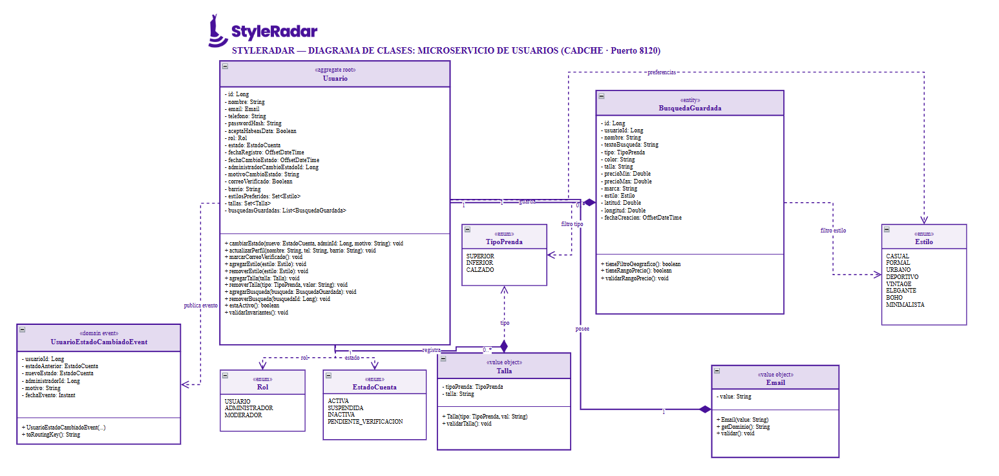
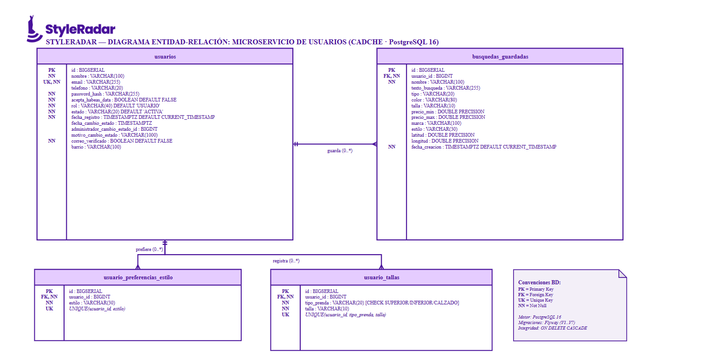
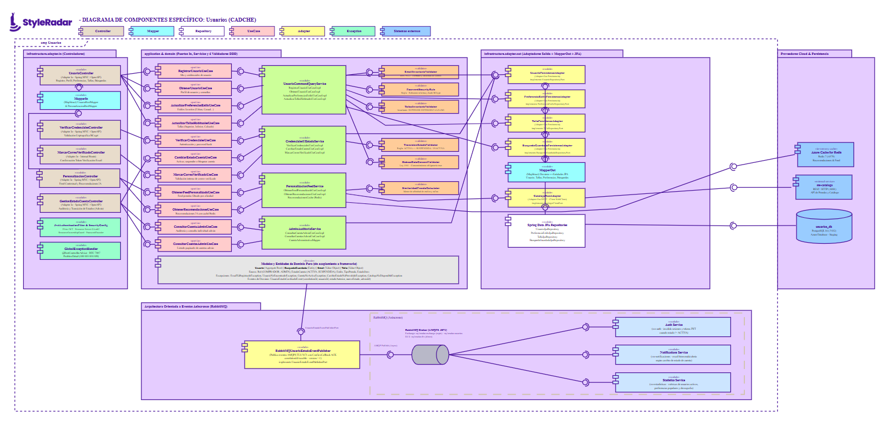

# 3. Arquitectura hexagonal y diagramas

El microservicio `ms-usuarios` implementa una **arquitectura hexagonal (Ports and Adapters)**, que separa las reglas de negocio de los mecanismos de entrada, persistencia e integración con otros servicios.

Esta arquitectura permite mantener el dominio independiente de frameworks, bases de datos y protocolos de comunicación.

## 3.1. Capas de la arquitectura

| Capa | Responsabilidad | Componentes principales |
|---|---|---|
| **Infraestructura de entrada (Driving Adapters)** | Recibe solicitudes HTTP y eventos externos. | `UsuarioController`, `AdminUsuarioController`, `PersonalizacionController`, `GestionEstadoCuentaController`, `AuthEventsListener`. |
| **Aplicación (Application Layer)** | Coordina la ejecución de los casos de uso y servicios. | Use Cases, servicios de aplicación y DTO Mappers. |
| **Dominio (Domain Core)** | Contiene las reglas de negocio y los modelos principales. | `Usuario`, `BusquedaGuardada`, Value Objects, eventos y excepciones de dominio. |
| **Infraestructura de salida (Driven Adapters)** | Implementa la persistencia y las integraciones externas. | Adaptadores de repositorio, RabbitMQ Publisher y clientes externos. |

## 3.2. Justificación de la arquitectura

La arquitectura hexagonal permite:

- **Separación de responsabilidades:** los controladores no contienen reglas de negocio y los adaptadores no definen las políticas del dominio.
- **Independencia del dominio:** las entidades y reglas de negocio no dependen de Spring, JPA ni de los controladores REST.
- **Facilidad de pruebas:** los casos de uso pueden probarse mediante interfaces y dependencias simuladas.
- **Mantenibilidad:** permite cambiar mecanismos de persistencia o comunicación sin modificar directamente las reglas del dominio.

## 3.3. Diagramas UML del servicio

Los diagramas se encuentran organizados en `docs/uml/` y sus archivos editables en `docs/diagramas/drawio/`.

### 3.3.1. Diagrama de clases

Representa las entidades, modelos, enumeraciones, Value Objects y relaciones del dominio de `ms-usuarios`.

<div align="center">
  
</div>

**Archivo editable:** [DiagramaClases.drawio](../diagramas/drawio/DiagramaClases.drawio).

### 3.3.2. Diagrama de base de datos

Representa la estructura de persistencia del microservicio, sus tablas, relaciones y atributos.

<div align="center">
  
</div>

**Archivo editable:** [DiagramaBaseDatos.drawio](../diagramas/drawio/DiagramaBaseDatos.drawio).

### 3.3.3. Diagrama de componentes específico

Representa los componentes internos del microservicio, sus puertos, adaptadores y relaciones dentro de la arquitectura hexagonal.

<div align="center">
  
</div>

**Archivo editable:** [DiagramaComponentesEspecifico.drawio](../diagramas/drawio/DiagramaComponentesEspecifico.drawio).

## 3.4. Estructura de paquetes

La organización principal del código fuente es la siguiente:

```text
src/main/java/edu/dosw/styleradar/usuarios/
├── UsuariosApplication.java
├── domain/
│   ├── model/
│   ├── event/
│   ├── exception/
│   └── port/
│       ├── in/
│       └── out/
├── application/
│   ├── dto/
│   │   ├── request/
│   │   ├── response/
│   │   └── event/
│   ├── mapper/
│   │   ├── in/
│   │   └── out/
│   ├── service/
│   │   └── impl/
│   └── usecase/
└── infrastructure/
    ├── adapter/
    │   ├── in/
    │   │   ├── rest/
    │   │   ├── amqp/
    │   │   └── websocket/
    │   └── out/
    │       ├── persistence/
    │       ├── security/
    │       ├── messaging/
    │       └── external/
    ├── config/
    └── exception/
```

**Nota:** esta estructura representa la organización arquitectónica documentada del servicio. Los componentes y clases específicos se detallan en el código fuente.

---

[← Anterior: 2. Equipo y responsables](02-equipo-responsables.md) · [Índice principal](../../README.md) · [Siguiente: 4. Endpoints y Swagger](04-endpoints-swagger.md)
