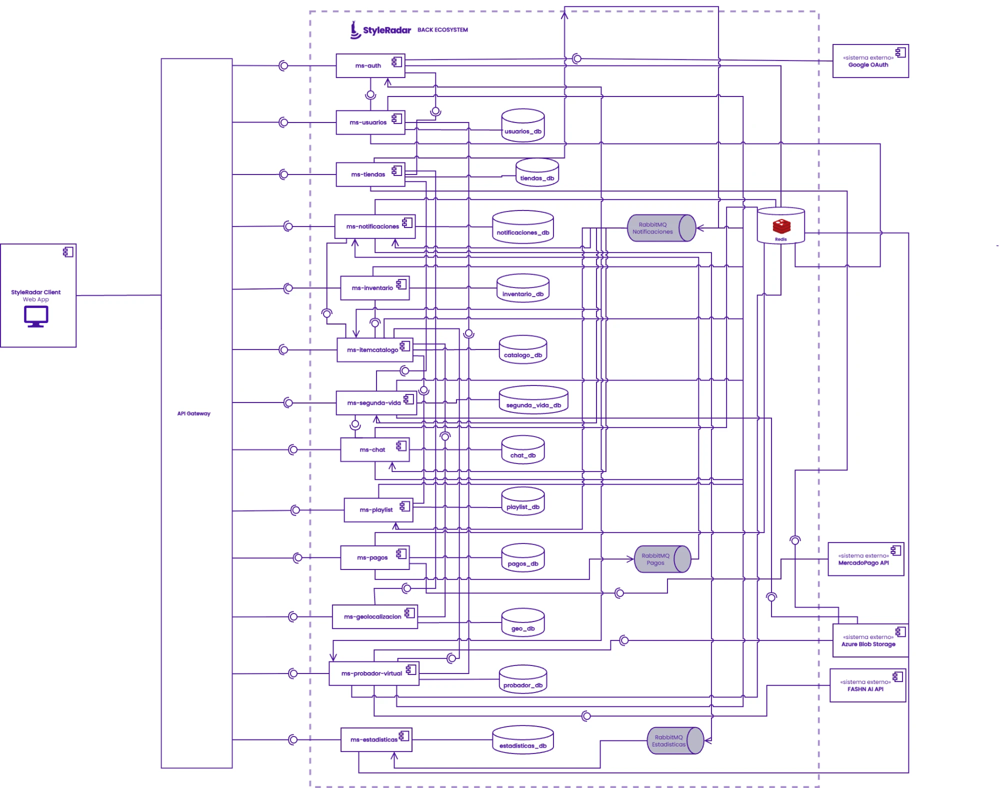
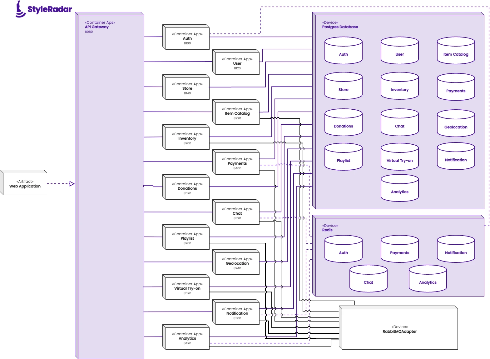
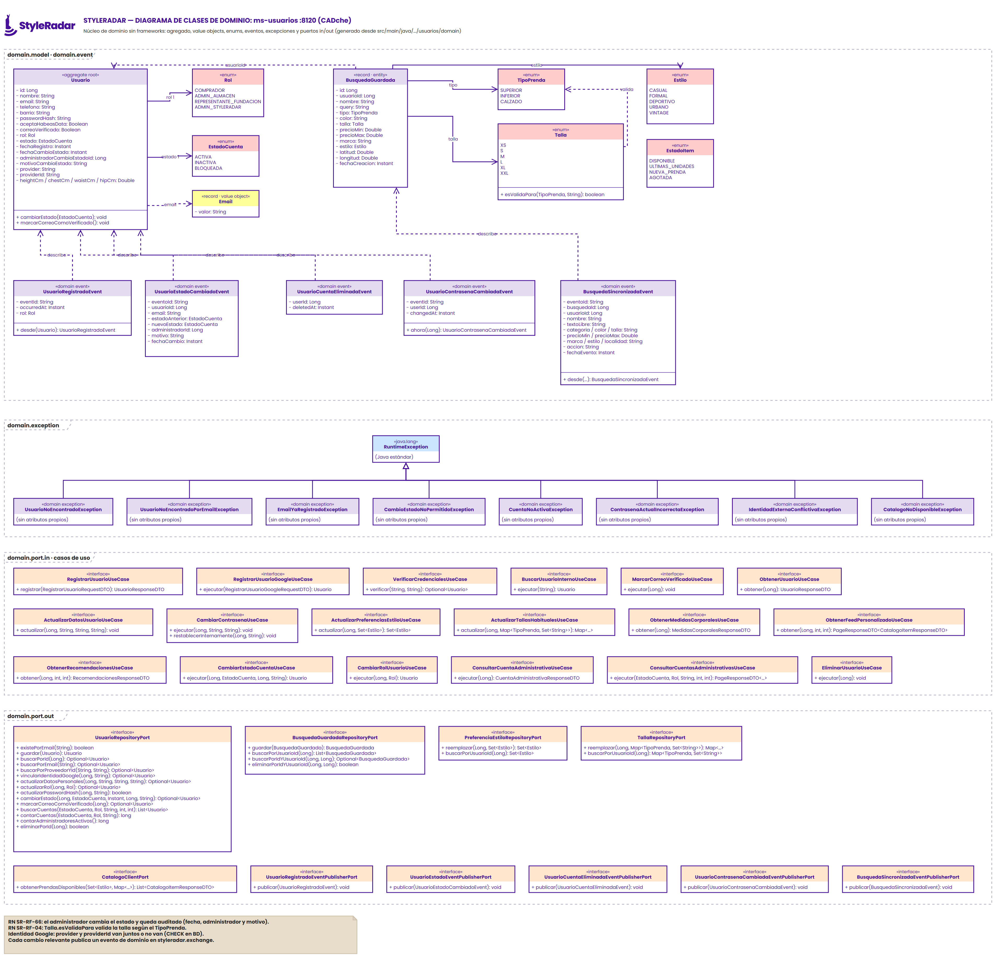
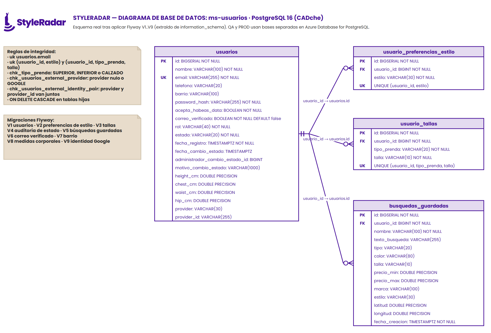
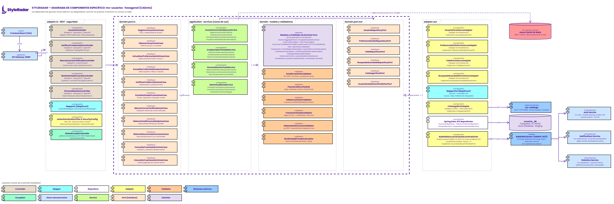

# 2. Arquitectura hexagonal y diagramas

El microservicio `ms-usuarios` implementa una **arquitectura hexagonal (Ports and Adapters)**, que separa las reglas de negocio de los mecanismos de entrada, persistencia e integración con otros servicios.

Esta arquitectura permite mantener el dominio independiente de frameworks, bases de datos y protocolos de comunicación.

## 2.1. Capas de la arquitectura

| Capa | Responsabilidad | Componentes principales |
|---|---|---|
| **Infraestructura de entrada (Driving Adapters)** | Recibe solicitudes HTTP y eventos externos. | `UsuarioController`, `AdminUsuarioController`, `PersonalizacionController`, `GestionEstadoCuentaController`, `AuthEventsListener`. |
| **Aplicación (Application Layer)** | Coordina la ejecución de los casos de uso y servicios. | Use Cases, servicios de aplicación y DTO Mappers. |
| **Dominio (Domain Core)** | Contiene las reglas de negocio y los modelos principales. | `Usuario`, `BusquedaGuardada`, Value Objects, eventos y excepciones de dominio. |
| **Infraestructura de salida (Driven Adapters)** | Implementa la persistencia y las integraciones externas. | Adaptadores de repositorio, RabbitMQ Publisher y clientes externos. |

## 2.2. Justificación de la arquitectura

La arquitectura hexagonal permite:

- **Separación de responsabilidades:** los controladores no contienen reglas de negocio y los adaptadores no definen las políticas del dominio.
- **Independencia del dominio:** las entidades y reglas de negocio no dependen de Spring, JPA ni de los controladores REST.
- **Facilidad de pruebas:** los casos de uso pueden probarse mediante interfaces y dependencias simuladas.
- **Mantenibilidad:** permite cambiar mecanismos de persistencia o comunicación sin modificar directamente las reglas del dominio.

## 2.3. Diagramas UML del servicio

Los diagramas y sus archivos editables (`.drawio`) están en `docs/uml/`. Usan la plantilla StyleRadar del repositorio base: logo, título «STYLERADAR — DIAGRAMA DE …», fuente Poppins y un color por tipo de elemento.

### 2.3.1. Diagrama de componentes general

Ubica a `ms-usuarios` dentro del ecosistema StyleRadar: el cliente web entra por el API Gateway, cada microservicio tiene su propia base de datos (`usuarios_db` para este servicio) y se comunican por RabbitMQ, con Redis y sistemas externos como Google OAuth, MercadoPago, Azure Blob Storage y FASHN AI.

<div align="center">
  
</div>

### 2.3.2. Diagrama de despliegue

Muestra cómo se despliega el ecosistema: la aplicación web llega al API Gateway (8080), que enruta a cada microservicio (User en el 8120); las bases PostgreSQL, Redis y RabbitMQ corren como nodos aparte.

<div align="center">
  
</div>

### 2.3.3. Diagrama de clases

Generado desde `src/main/java/.../usuarios/domain`: el agregado `Usuario`, la entidad `BusquedaGuardada`, el value object `Email`, los enums (`Rol`, `EstadoCuenta`, `Estilo`, `TipoPrenda`, `Talla`, `EstadoItem`), los cinco eventos de dominio, las excepciones y los puertos de entrada y salida.

<div align="center">
  
</div>

**Archivo editable:** [DiagramaClases.drawio](../uml/DiagramaClases.drawio).

### 2.3.4. Diagrama de base de datos

Esquema real de PostgreSQL después de aplicar las migraciones Flyway V1 a V9: `usuarios` y sus tablas hijas `usuario_preferencias_estilo`, `usuario_tallas` y `busquedas_guardadas`, todas con `ON DELETE CASCADE`.

<div align="center">
  
</div>

**Archivo editable:** [DiagramaBaseDatos.drawio](../uml/DiagramaBaseDatos.drawio).

### 2.3.5. Diagrama de componentes específico

Representa los componentes internos del microservicio, sus puertos, adaptadores y relaciones dentro de la arquitectura hexagonal.

<div align="center">
  
</div>

**Archivo editable:** [DiagramaComponentesEspecifico.drawio](../uml/DiagramaComponentesEspecifico.drawio).

## 2.4. Estructura de paquetes

La organización principal del código fuente es la siguiente:

```text
src/main/java/edu/dosw/styleradar/usuarios/
├── UsuariosApplication.java
├── domain/
│   ├── model/
│   ├── event/
│   ├── exception/
│   └── port/
│       ├── in/
│       └── out/
├── application/
│   ├── dto/
│   │   ├── request/
│   │   ├── response/
│   │   └── event/
│   ├── mapper/
│   │   ├── in/
│   │   └── out/
│   ├── service/
│   │   └── impl/
│   └── usecase/
└── infrastructure/
    ├── adapter/
    │   ├── in/
    │   │   ├── rest/
    │   │   ├── amqp/
    │   │   └── websocket/
    │   └── out/
    │       ├── persistence/
    │       ├── security/
    │       ├── messaging/
    │       └── external/
    ├── config/
    └── exception/
```

**Nota:** esta estructura representa la organización arquitectónica documentada del servicio. Los componentes y clases específicos se detallan en el código fuente.

---

[← Anterior: 1. Servicio](01-nombre-servicio-bounded-context.md) · [Índice principal](../../README.md) · [Siguiente: 3. Endpoints y Swagger](03-endpoints-swagger.md)
