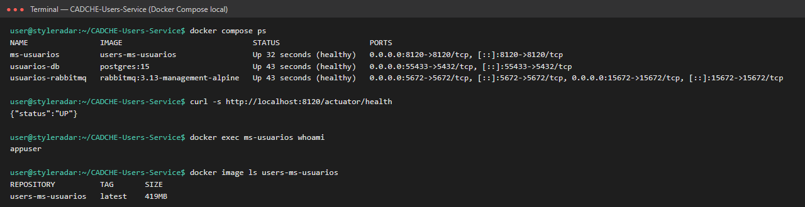

# 6. Cómo ejecutar local y con Docker

El microservicio `ms-usuarios` puede ejecutarse localmente mediante Maven o utilizando Docker Compose.

## 6.1. Requisitos previos

Antes de ejecutar el servicio se necesita:

| Herramienta | Uso |
|---|---|
| Java 21 | Ejecución de la aplicación. |
| Maven Wrapper (`./mvnw`) | Compilación y gestión de dependencias; descarga Maven 3.9.16 si no está instalado. |
| PostgreSQL | Persistencia de información (incluido en `docker-compose.yml`). |
| Docker Desktop | Ejecución mediante contenedores. |
| RabbitMQ | Comunicación asíncrona con otros microservicios (incluido en `docker-compose.yml`). |

## 6.2. Clonar el repositorio

```bash
git clone https://github.com/StyleRadar1/CADCHE-Users-Service.git
cd CADCHE-Users-Service
```

## 6.3. Configuración de variables de entorno

Antes de ejecutar la aplicación, configura las variables requeridas en el entorno o archivo `.env`.

Consulta la [Sección 7: Variables de entorno](07-variables-entorno.md).

No publiques credenciales, contraseñas ni secretos en el repositorio.

## 6.4. Ejecución local con Maven

Primero, compila el proyecto:

```bash
./mvnw clean install
```

Ejecuta las pruebas:

```bash
./mvnw test
```

Inicia la aplicación:

```bash
./mvnw spring-boot:run
```

El servicio utiliza por defecto el puerto `8120`.

```text
http://localhost:8120
```

Swagger UI:

```text
http://localhost:8120/swagger-ui/index.html
```

## 6.5. Ejecución con Docker Compose

El repositorio incluye un `Dockerfile` multi-etapa y un `docker-compose.yml` que levanta la aplicación junto con PostgreSQL y RabbitMQ. La imagen corre con un usuario sin privilegios (`appuser`) y trae `HEALTHCHECK` contra `/actuator/health`. El pipeline usa `Dockerfile.runtime`, que solo empaqueta el JAR ya probado.

Copia la plantilla y ajusta los valores:

```bash
cp .env.example .env
```

Si el puerto 5432 o 5672 ya está ocupado en tu equipo, cambia `POSTGRES_PORT_EXTERNAL` o `RABBITMQ_PORT_EXTERNAL` en el `.env`.

Construye e inicia los contenedores:

```bash
docker compose up --build -d
```

Consulta los contenedores activos:

```bash
docker compose ps
```

Consulta los registros de la aplicación:

```bash
docker compose logs -f ms-usuarios
```

Detén los servicios:

```bash
docker compose down
```

Para eliminar también los volúmenes de datos:

```bash
docker compose down -v
```

**Advertencia:** el último comando elimina los datos persistidos en el volumen de PostgreSQL.

## 6.6. Servicios y puertos

| Servicio | Puerto del contenedor | Puerto local |
|---|---:|---:|
| `ms-usuarios` | `8120` | `8120` |
| `usuarios-db` | `5432` | `POSTGRES_PORT_EXTERNAL` (por defecto `5432`) |
| `usuarios-rabbitmq` | `5672` / `15672` | `RABBITMQ_PORT_EXTERNAL` / `RABBITMQ_MGMT_PORT_EXTERNAL` (por defecto `5672` / `15672`) |

El `docker-compose.yml` define los tres contenedores; `ms-usuarios` espera a que la base de datos y RabbitMQ estén sanos antes de arrancar.

## 6.7. Verificación de funcionamiento

Comprueba el estado de la aplicación mediante Actuator:

```bash
curl http://localhost:8120/actuator/health
```

Respuesta esperada cuando la aplicación está disponible:

```json
{
  "status": "UP"
}
```

**Evidencia Docker Compose** (ejecución local del 25/11/2026: los tres contenedores sanos, health `UP` y la aplicación corriendo como `appuser`):

<div align="center">
  
</div>

También puedes abrir Swagger UI:

```text
http://localhost:8120/swagger-ui/index.html
```

---

[← Anterior: 5. Tecnologías](05-tecnologias-dependencias.md) · [Índice principal](../../README.md) · [Siguiente: 7. Variables de entorno](07-variables-entorno.md)
