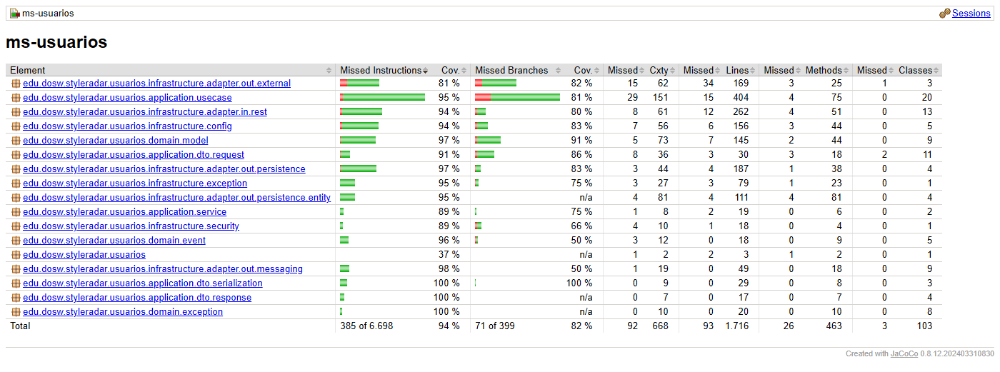

# 8. Pruebas y cobertura

El microservicio `ms-usuarios` cuenta con pruebas automatizadas para validar el comportamiento de sus componentes y verificar que las funcionalidades principales trabajen correctamente.

## 8.1. Herramientas utilizadas

| Herramienta | Uso |
|---|---|
| JUnit 5 | Ejecución de pruebas automatizadas. |
| Mockito | Simulación de dependencias durante las pruebas. |
| Spring Boot Test | Pruebas de componentes e integración de Spring Boot. |
| Testcontainers | Ejecución de pruebas que requieren servicios externos en contenedores. |
| JaCoCo | Generación de reportes de cobertura de código. |

## 8.2. Organización de las pruebas

Las pruebas se encuentran en:

`src/test/java/edu/dosw/styleradar/usuarios/`

Están organizadas de acuerdo con las principales capas del proyecto:

- **Application:** pruebas de casos de uso, como registro de usuarios, actualización de tallas y consulta de información.
- **Domain:** pruebas de objetos y reglas del dominio, como correo electrónico y tallas.
- **Infrastructure:** pruebas de controladores REST, persistencia, adaptadores externos y manejo de excepciones.

También existen pruebas relacionadas con la verificación del correo electrónico, la gestión del estado de las cuentas y la verificación de credenciales.

## 8.3. Ejecución de las pruebas

Desde la raíz del proyecto se pueden ejecutar los siguientes comandos:

Ejecutar todas las pruebas:

```bash
./mvnw test
```

Compilar y ejecutar las pruebas:

```bash
./mvnw clean verify
```

El segundo comando también permite generar el reporte de cobertura configurado con JaCoCo.

## 8.4. Reporte de cobertura

El proyecto utiliza JaCoCo versión `0.8.12`.

Después de ejecutar:

```bash
./mvnw clean verify
```

El reporte HTML de cobertura se genera en:

`target/site/jacoco/index.html`

Este reporte permite consultar qué partes del código fueron ejecutadas durante las pruebas y cuáles necesitan mayor validación.

## 8.5. Umbral y métricas actuales

`pom.xml` ejecuta `jacoco:check` en la fase `verify`: el build falla si la cobertura baja del mínimo.

| Métrica | Mínimo exigido | Medición actual (25/11/2026) |
|---|---:|---:|
| Líneas | 85 % | 94,6 % (1.623 de 1.716) |
| Ramas | 80 % | 82,2 % (328 de 399) |
| Instrucciones | 85 % | 94,3 % (6.313 de 6.698) |

La suite tiene 260 pruebas en 51 clases (1 omitida).

**Evidencia JaCoCo:**

<div align="center">
  
</div>

## 8.6. Consideraciones

- Las pruebas deben ejecutarse antes de realizar una entrega o integrar cambios.
- Algunas pruebas de integración utilizan Testcontainers y requieren que Docker esté disponible.
- Si Docker no está iniciado o no se encuentra correctamente configurado, las pruebas que dependen de contenedores pueden fallar.
- JaCoCo exige 85 % de líneas e instrucciones y 80 % de ramas; si una rama baja de ese mínimo, `./mvnw verify` y el pipeline fallan.

---

[← Anterior: 7. Variables de entorno](07-variables-entorno.md) · [Índice](../../README.md) · [Siguiente: 9. CI/CD](09-cicd-pipeline.md)
