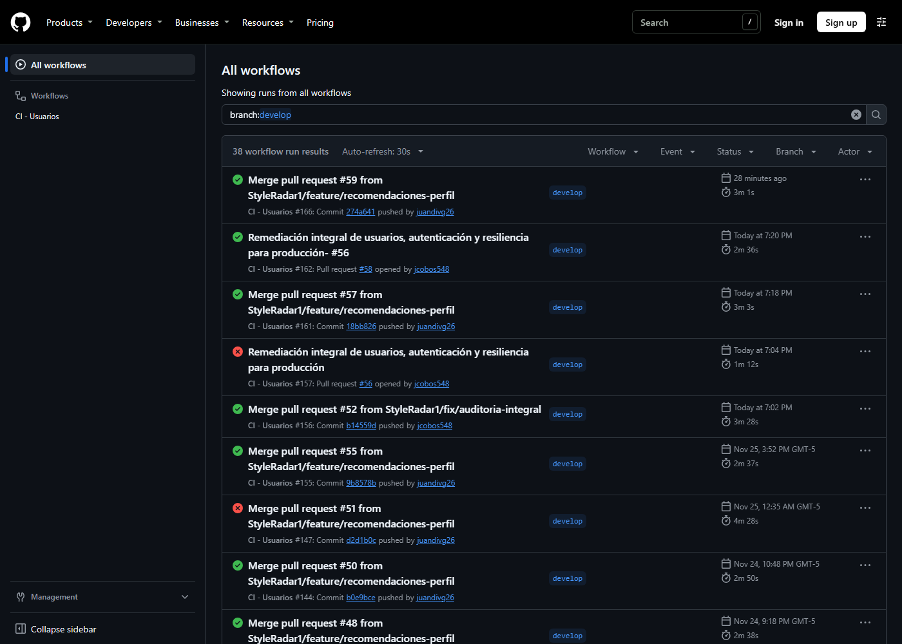
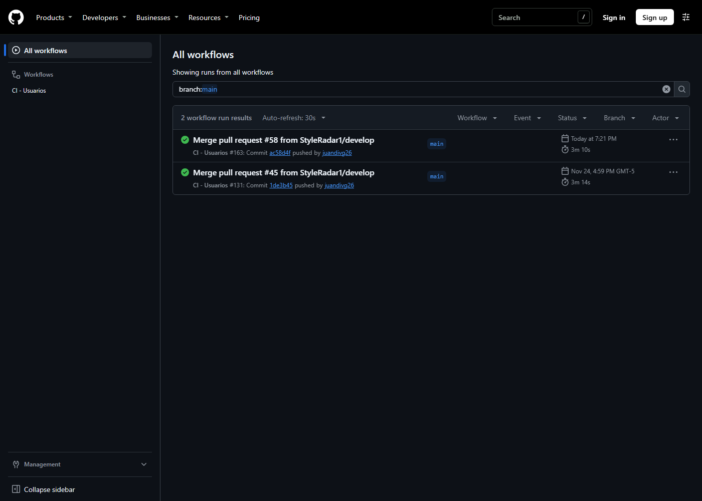

# 9. CI/CD y pipeline

El microservicio `ms-usuarios` utiliza GitHub Actions para automatizar la integración continua, la ejecución de pruebas, el análisis de código, la construcción de imágenes Docker y el despliegue en Azure.

El pipeline está separado en tres archivos, como el repositorio base:

| Archivo | Cuándo corre | Qué hace |
|---|---|---|
| [`ci.yml`](../../.github/workflows/ci.yml) | Pull Request hacia `develop` o `main`, y `push` a ramas de trabajo | Pruebas, cobertura, SpotBugs, SonarQube Cloud y construcción de la imagen Docker sin publicarla. No despliega. |
| [`ci-qa.yml`](../../.github/workflows/ci-qa.yml) | `push` a `develop` (merge de un PR) o ejecución manual seleccionando `develop` | Lo mismo de `ci.yml`, publica la imagen con etiqueta `qa`, despliega en QA y hace smoke test. |
| [`ci-prod.yml`](../../.github/workflows/ci-prod.yml) | `push` a `main` (o ejecución manual seleccionando `main`) | Lo mismo, valida la configuración de PROD, publica la imagen con etiqueta `prod`, despliega en PROD y hace smoke test. |

Badges:

[](https://github.com/StyleRadar1/CADCHE-Users-Service/actions/workflows/ci.yml)
[](https://github.com/StyleRadar1/CADCHE-Users-Service/actions/workflows/ci-qa.yml)
[](https://github.com/StyleRadar1/CADCHE-Users-Service/actions/workflows/ci-prod.yml)

```text
PR / rama de trabajo ── ci.yml ──► build + pruebas + JaCoCo ≥ 85 % ─► SpotBugs ─► SonarQube ─► docker build (sin publicar)
develop ─────────────── ci-qa.yml ─► build + pruebas ─► SonarQube ─► imagen :qa en ACR ─► App Service QA ─► smoke test
main ────────────────── ci-prod.yml ► build + pruebas ─► Quality Gate Sonar ─► imagen :prod en ACR ─► validaciones PROD ─► App Service PROD ─► smoke test
```

## 9.1. Build y pruebas

Los tres archivos usan Ubuntu, Java 21 y el Maven Wrapper:

1. Descargar el código del repositorio.
2. Configurar Java 21.
3. Ejecutar `./mvnw clean verify` con un servicio PostgreSQL 16 (reintenta si Maven Central responde 429).
4. Fallar si JaCoCo mide menos de 85 % de líneas e instrucciones o 80 % de ramas.
5. Realizar análisis estático con SpotBugs.
6. Guardar el reporte JaCoCo y el JAR validado.

## 9.2. Análisis de calidad

| Herramienta | Función |
|---|---|
| JUnit y Mockito | Ejecución de pruebas automatizadas. |
| JaCoCo | Reporte de cobertura y umbral mínimo (`jacoco:check`). |
| SpotBugs | Análisis estático para detectar posibles errores en el código. |
| SonarQube Cloud | Análisis de calidad y revisión del código. |

En QA y PROD el análisis espera el resultado del Quality Gate de SonarQube; la imagen solo se publica si el build y el Quality Gate pasan.

## 9.3. Construcción y publicación de imágenes Docker

La imagen se construye con `Dockerfile.runtime` (usuario sin privilegios y `HEALTHCHECK`) a partir del JAR ya probado, y se publica en Azure Container Registry:

`styleradarusersacr.azurecr.io`

| Archivo | Etiquetas |
|---|---|
| `ci.yml` | Ninguna: solo valida que la imagen construye. |
| `ci-qa.yml` | SHA del commit y `qa` |
| `ci-prod.yml` | SHA del commit y `prod` |

## 9.4. Despliegue en QA

`ci-qa.yml` despliega al hacer `push` a `develop` o mediante ejecución manual seleccionando `develop`. Los Pull Requests ya no despliegan a QA: QA muestra siempre lo que está integrado en `develop`, como en el repositorio base. Los jobs de publicación y despliegue están restringidos a esa rama.

El pipeline realiza las siguientes actividades:

1. Autenticarse en Azure.
2. Configurar la imagen Docker del microservicio en Azure App Service.
3. Configurar el puerto `8120`.
4. Activar Flyway mediante `FLYWAY_ENABLED=true`.
5. Establecer el perfil de Spring `qa`.
6. Reiniciar la aplicación.
7. Smoke test: esperar a que `/actuator/health` responda 200 (hasta 5 minutos) y reintentar hasta 3 veces `/v3/api-docs` ante respuestas transitorias, con timeout por solicitud.

El App Service configurado es:

`styleradar-qa-app`

## 9.5. Despliegue en producción

El despliegue en producción lo hace `ci-prod.yml` cuando se realiza un `push` a la rama `main`. No se despliega PROD desde etiquetas. La ejecución manual solo publica y despliega si se selecciona `main`.

Antes del despliegue, el pipeline verifica que la variable `PROD_DATABASE_VERIFIED` tenga el valor `true`.

Esta variable se configura en GitHub, en **Settings → Secrets and variables → Actions → Variables**. Establécela en `true` únicamente después de confirmar que PostgreSQL de PROD existe, que `DB_URL` apunta a esa instancia y que la aplicación puede conectarse. Después de guardar la variable, se puede volver a ejecutar el job fallido de despliegue.

También comprueba que el App Service tenga configuradas las variables necesarias para la conexión a PostgreSQL y la seguridad:

- `DB_URL`
- `DB_USERNAME`
- `DB_PASSWORD`
- `INTERNAL_AUTH_USERNAME`
- `INTERNAL_AUTH_PASSWORD`
- `JWT_SECRET_BASE64` o `JWT_SECRET`

Si alguna validación falla, el despliegue se detiene.

Cuando las validaciones son correctas, se configura la imagen Docker en Azure App Service, se activa Flyway y se reinicia la aplicación. Al final, el smoke test espera a que `/actuator/health` de PROD responda 200.

## 9.6. Secretos y variables de GitHub

El pipeline utiliza secretos y variables configurados en GitHub para autenticarse en Azure y acceder a la configuración del despliegue. PROD solo se publica desde `main`, después de verificar PostgreSQL mediante `PROD_DATABASE_VERIFIED=true`, aprobar el Quality Gate y comprobar los App Settings requeridos.

## 9.7. Evidencia

**Ejecuciones en `develop` (QA):**

<div align="center">
  
</div>

**Ejecuciones en `main` (PROD):**

<div align="center">
  
</div>

Las capturas son del 25/11/2026, antes de separar el pipeline; muestran el `ci.yml` anterior y no documentan el flujo vigente.

---

[← Anterior: 8. Pruebas y cobertura](08-pruebas-cobertura.md) · [Índice](../../README.md) · [Siguiente: 10. Ramas y contribución](10-ramas-contribuir.md)
