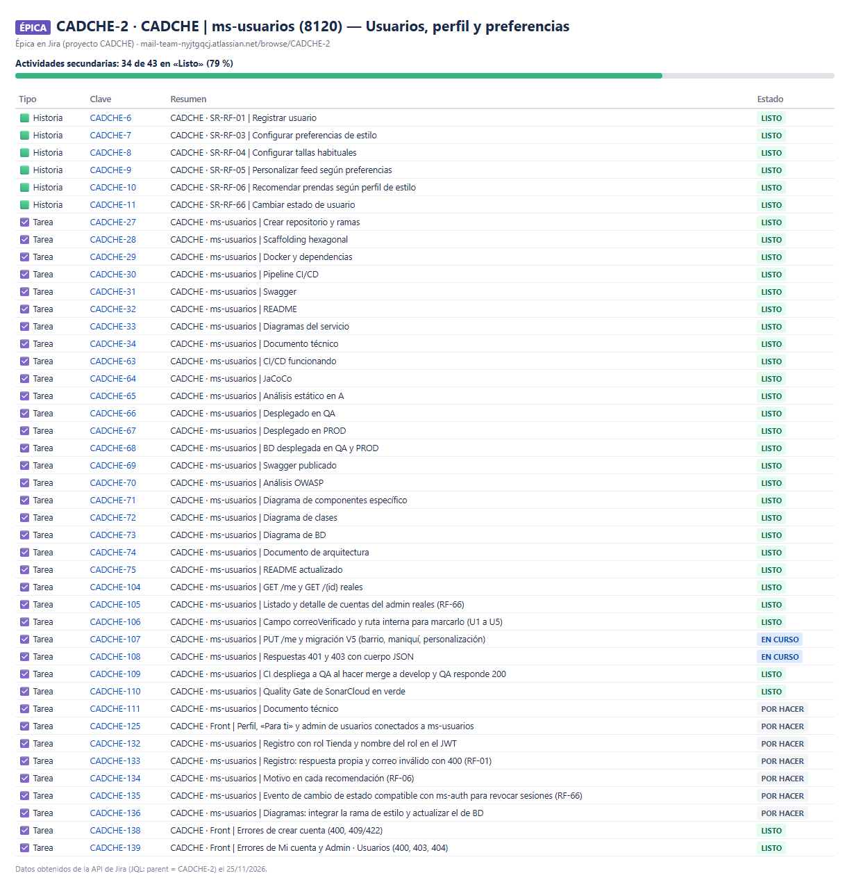

# 12. Equipo, épica y requerimientos

Desarrollado y mantenido por el squad `CADche` para DOSW 2026.

## 12.1. Responsables

| Rol | Nombre | GitHub |
|---|---|---|
| Tech Lead, arquitecto y backend developer | Julian Camilo Giral | [@jcobos548](https://github.com/jcobos548) |
| Product Owner, Scrum Master y backend developer | Juan Diego Gaitan | [@mamagege](https://github.com/mamagege) |

## 12.2. Seguimiento

- **Épica y tablero CADCHE:** [Jira](https://mail-team-nyjtgqcj.atlassian.net/jira/software/projects/CADCHE/boards/75/backlog)
- **Swagger QA:** [API QA](https://styleradar-qa-app.azurewebsites.net/swagger-ui/index.html)
- **Swagger PROD:** [API PROD](https://styleradar-prod-app.azurewebsites.net/swagger-ui/index.html)

**Evidencias** (carpeta [`docs/evidencias/`](../evidencias/), 25/11/2026):

| Evidencia | Dónde se muestra |
|---|---|
| Swagger QA y PROD | [Sección 3](03-endpoints-swagger.md) |
| Docker Compose | [Sección 6](06-ejecucion-local-docker.md) |
| JaCoCo | [Sección 8](08-pruebas-cobertura.md) |
| Pipeline QA y PROD | [Sección 9](09-cicd-pipeline.md) |
| Épica de Jira | Abajo |

**Épica CADCHE-2 en Jira** (datos tomados de la API de Jira con `parent = CADCHE-2`):

  

## 12.3. Requerimientos funcionales

| Código | Requerimiento | Actor |
|---|---|---|
| `SR-RF-01` | Registro y consulta de perfil de usuario. | Comprador |
| `SR-RF-03` | Preferencias de estilo. | Comprador |
| `SR-RF-04` | Tallas habituales por tipo de prenda. | Comprador |
| `SR-RF-05` | Feed personalizado de prendas. | Comprador |
| `SR-RF-06` | Recomendaciones según perfil de estilo. | Comprador |
| `SR-RF-28` | Guardar, consultar y eliminar búsquedas guardadas. | Comprador |
| `SR-RF-66` | Consultar cuentas y administrar sus estados. | Administrador StyleRadar |
| `SR-RF-115` | Eliminar cuentas desde el panel administrativo. | Administrador StyleRadar |

---

[← Anterior: 11. Seguridad y OWASP](11-seguridad-owasp.md) · [Índice principal](../../README.md)
